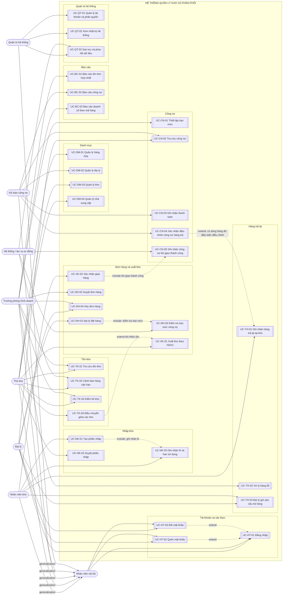
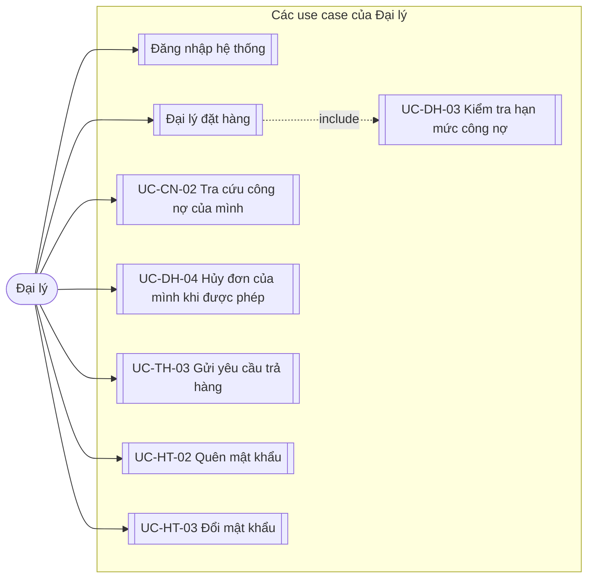
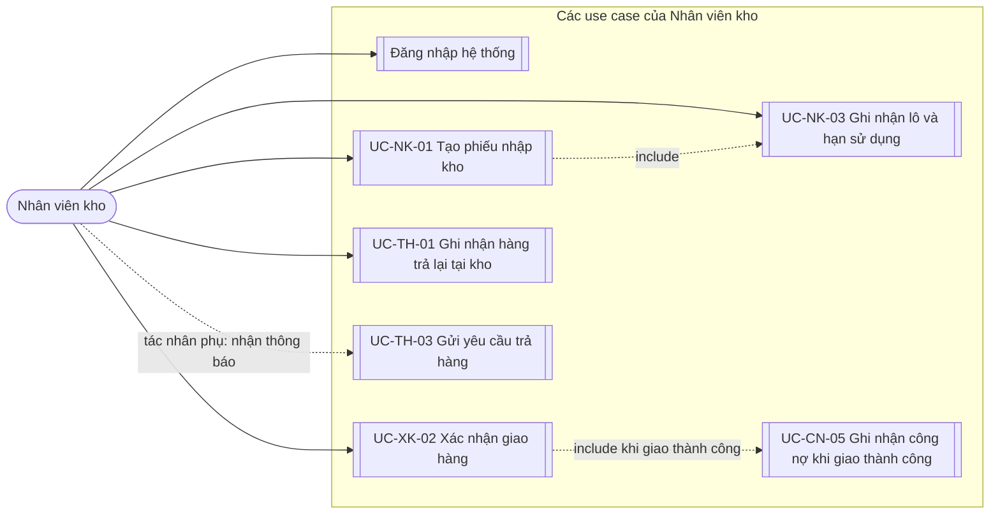
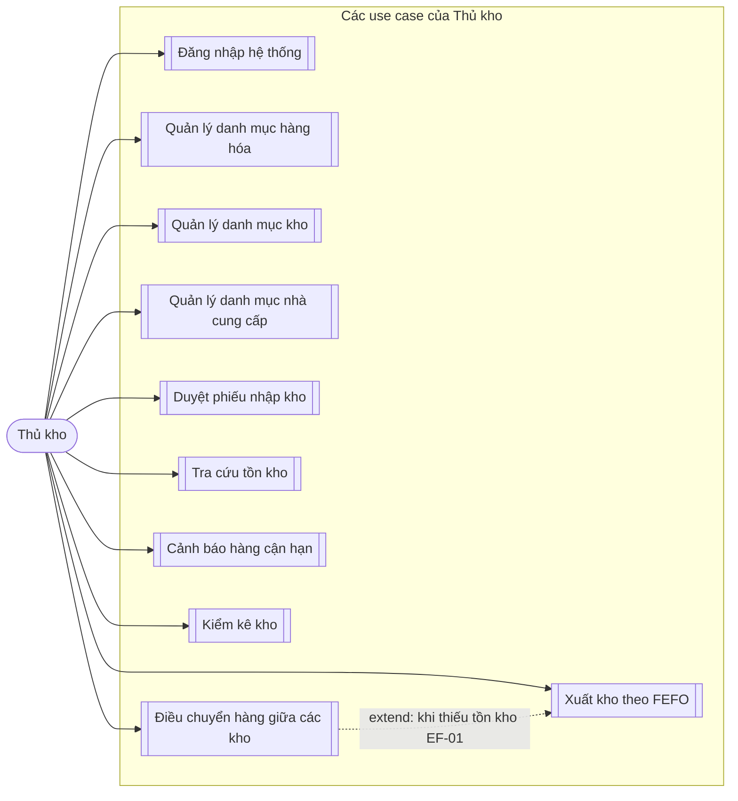
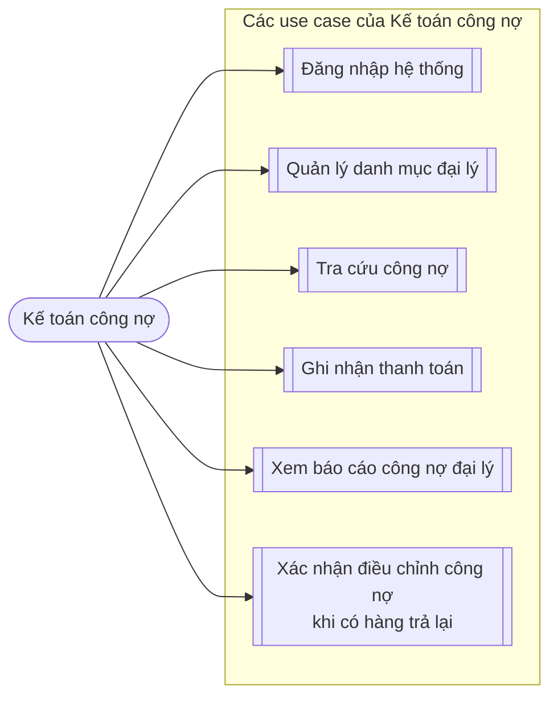
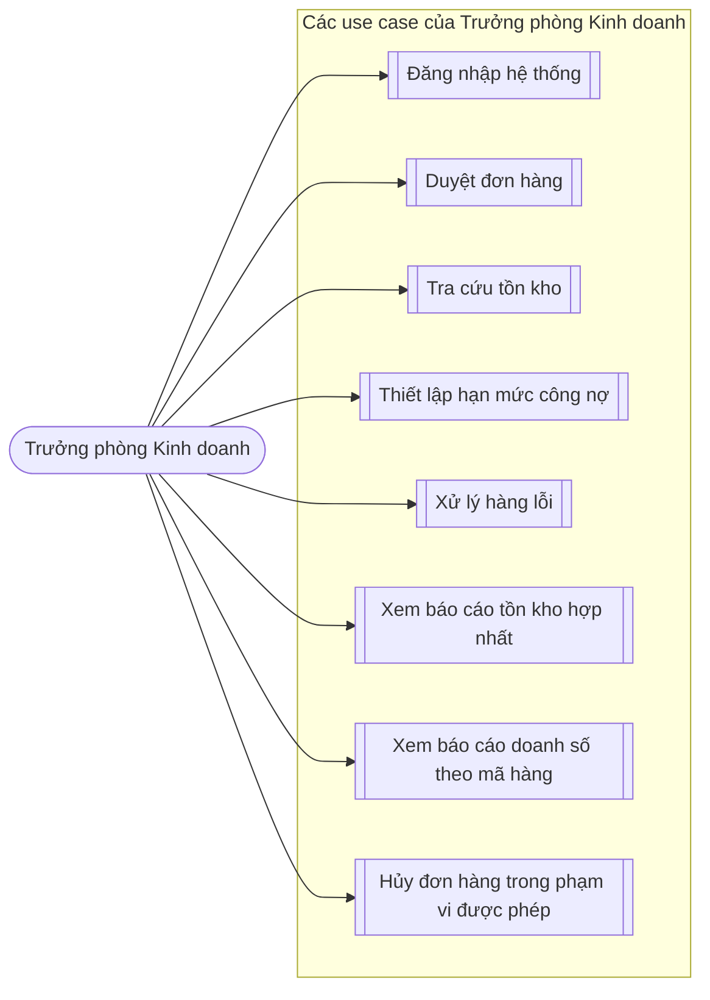
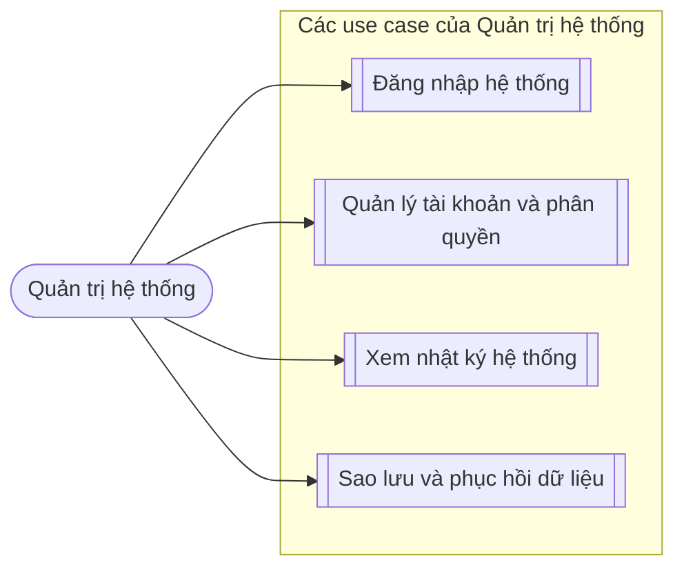

# Yêu cầu hệ thống

Tài liệu gồm:
- Nguồn yêu cầu và luật nghiệp vụ (2.5)
- Phân rã chức năng (3.1–3.2)
- Yêu cầu chức năng/phi chức năng (3.3)
- Use case và đặc tả (5.1–5.3)
- Danh sách tác nhân (Bảng 2.1) xem tại [Tổng quan dự án](01-overview.md#5-đối-tượng-sử-dụng).

## 2.5. Kịch bản khảo sát giả lập và kết quả dự kiến

Các nội dung dưới đây là **kết quả giả lập theo 6 nhóm tác nhân** để phục vụ phân tích và thiết kế dự án, không phải kết quả phỏng vấn/khảo sát thực tế.

<p align="center"><b>Bảng 2.2. Tổng hợp kết quả khảo sát theo nhóm đối tượng</b></p>

| Tác nhân | Mục tiêu khảo sát | Kết quả thu được |
|---|---|---|
| AC-01 Đại lý | Quy trình đặt hàng và hạn mức tín dụng hiện tại | Đại lý đặt hàng qua điện thoại cho nhân viên kinh doanh phụ trách; không biết được hạn mức công nợ còn lại của mình cho đến khi bị từ chối đơn |
| AC-02 Nhân viên kho | Quy trình xuất - nhập kho, nguyên nhân lệch tồn | Ghi phiếu giấy rồi nhập lại vào Excel cuối ngày; lệch tồn phát sinh do nhập sai hoặc quên nhập phiếu |
| AC-03 Thủ kho | Quy tắc xuất kho theo hạn sử dụng, quản lý 600 mã hàng | Thực tế nhân viên chủ yếu dựa vào thứ tự nhập (FIFO) và kinh nghiệm; chưa áp dụng FEFO nhất quán, đồng thời chưa có cảnh báo hàng cận hạn |
| AC-04 Kế toán công nợ | Cách theo dõi công nợ, hạn mức, xử lý hàng trả lại | Theo dõi bằng file Excel riêng, đối chiếu thủ công cuối tháng với sổ kho |
| AC-05 Trưởng phòng KD | Yêu cầu báo cáo tồn kho theo thời gian thực | Hiện phải chờ tổng hợp từ 3 kho, số liệu thường trễ 1-2 ngày và không khớp nhau |
| AC-06 Quản trị hệ thống | Yêu cầu phân quyền và bảo mật dữ liệu | Hiện file Excel dùng chung, ai cũng sửa được, không truy vết được người sửa |


<p align="center"><b>Bảng 2.3. Danh sách luật nghiệp vụ thu thập được</b></p>

| Mã BR | Phát biểu luật nghiệp vụ | Loại luật | Nguồn | Mức bắt buộc |
|---|---|---|---|---|
| BR-01 | Hàng xuất kho phải theo nguyên tắc hết hạn trước - xuất trước (FEFO): ưu tiên xuất lô có hạn sử dụng gần nhất; không được xuất lô có hạn sử dụng dài hơn khi còn lô sắp hết hạn cùng mã hàng trong cùng kho | Ràng buộc dữ liệu | Giả lập theo vai trò AC-03 Thủ kho | Bắt buộc |
| BR-02 | Mỗi đại lý có hạn mức công nợ tối đa. Trước khi nhận đơn mới vào trạng thái "Chờ duyệt", hệ thống kiểm tra `cong_no_hien_tai + cong_no_tam_tinh + max(0, giá trị đơn mới - số dư trả trước khả dụng chưa phân bổ có thể giữ chỗ cho đơn mới)` không vượt hạn mức. Số dư trả trước được giữ chỗ nguyên tử cho đơn, không được dùng trùng; chỉ phần giá trị đơn còn phải thu sau cấn trừ mới được cộng vào công nợ tạm tính. Khi duyệt, hệ thống không ghi nợ chính thức hoặc cộng lặp giá trị đơn. Công nợ chính thức chỉ tăng theo từng phiếu xuất giao thành công sau khi cấn trừ phần trả trước đã phân bổ tương ứng. | Ràng buộc dữ liệu | Giả lập theo vai trò AC-04 Kế toán công nợ | Bắt buộc |
| BR-03 | Hàng trả lại / hàng lỗi phải được ghi nhận vào khu vực hàng lỗi riêng (tách bằng trạng thái tồn kho), không cộng lại vào tồn kho bán được cho đến khi có quyết định xử lý từ quản lý | Quy tắc nghiệp vụ | Giả lập theo vai trò AC-02 Nhân viên kho | Bắt buộc |
| BR-04 | Hàng có hạn sử dụng còn dưới ngưỡng cảnh báo **30 ngày** *(giá trị đề xuất - xem lý do và giới hạn ở ghi chú)* phải được hệ thống cảnh báo cho thủ kho | Ràng buộc dữ liệu | Giả lập theo vai trò AC-03 Thủ kho | Bắt buộc |
| BR-05 | Mọi thao tác sửa số lượng tồn kho phải ghi nhật ký người thực hiện và thời điểm thực hiện | Ràng buộc nghiệp vụ | Giả lập theo vai trò AC-06 Quản trị hệ thống | Bắt buộc |

> **Về ngưỡng 30 ngày ở BR-04 - đây là giá trị đề xuất, không phải số liệu khảo sát thật:**
> - **30 ngày là mức phổ biến cho ngành hàng tiêu dùng nhanh (FMCG)** - đủ thời gian để thủ kho xử lý (ưu tiên xuất trước, đề nghị giảm giá, hoặc trả nhà cung cấp) trước khi hàng thực sự hết hạn.
> - **600 mã hàng của đề tài chắc chắn không cùng một loại hạn sử dụng** - hàng có hạn dùng 6 tháng và hàng có hạn dùng 2 năm không nên dùng chung một ngưỡng "30 ngày trước khi hết hạn", vì với hàng hạn dùng 2 năm thì 30 ngày là quá muộn để xử lý hết tồn.
> - **Hỏi thủ kho xem có phân loại hàng theo "nhóm hạn sử dụng" không** (ví dụ: ngắn hạn dưới 6 tháng / trung hạn 6 tháng-2 năm / dài hạn trên 2 năm), từ đó đặt ngưỡng cảnh báo riêng cho từng nhóm thay vì một con số chung - nếu áp dụng, cần bổ sung thuộc tính `nhom_han_dung` và `nguong_canh_bao_ngay` vào thực thể `HANG_HOA` ở Chương 4.

## 3.1. Sơ đồ phân rã chức năng

```
HỆ THỐNG QUẢN LÝ KHO VÀ PHÂN PHỐI
├── 1. Quản lý danh mục
│   ├── 1.1. Quản lý hàng hóa
│   ├── 1.2. Quản lý đại lý
│   ├── 1.3. Quản lý kho
│   └── 1.4. Quản lý nhà cung cấp
├── 2. Quản lý nhập kho
│   ├── 2.1. Tạo phiếu nhập
│   ├── 2.2. Ghi nhận lô hàng và hạn sử dụng
│   └── 2.3. Duyệt phiếu nhập
├── 3. Quản lý đơn hàng và xuất kho
│   ├── 3.1. Đại lý đặt hàng
│   ├── 3.2. Kiểm tra hạn mức công nợ
│   ├── 3.3. Duyệt đơn hàng
│   ├── 3.4. Tạo phiếu xuất theo FEFO
│   ├── 3.5. Xác nhận giao hàng
│   └── 3.6. Hủy đơn hàng
├── 4. Quản lý tồn kho
│   ├── 4.1. Tra cứu tồn kho theo kho
│   ├── 4.2. Cảnh báo hàng cận hạn sử dụng
│   ├── 4.3. Kiểm kê kho
│   └── 4.4. Điều chuyển hàng giữa các kho
├── 5. Quản lý công nợ
│   ├── 5.1. Thiết lập hạn mức đại lý
│   ├── 5.2. Theo dõi công nợ phát sinh
│   └── 5.3. Ghi nhận thanh toán
├── 6. Quản lý hàng trả lại
│   ├── 6.1. Tiếp nhận yêu cầu trả hàng
│   ├── 6.2. Ghi nhận vào khu vực hàng lỗi
│   └── 6.3. Xử lý hàng lỗi
├── 7. Báo cáo thống kê
│   ├── 7.1. Báo cáo tồn kho hợp nhất 3 kho
│   ├── 7.2. Báo cáo công nợ đại lý
│   └── 7.3. Báo cáo doanh số theo mã hàng
└── 8. Quản trị hệ thống
    ├── 8.1. Quản lý tài khoản và phân quyền
    ├── 8.2. Xem nhật ký hệ thống
    ├── 8.3. Sao lưu và phục hồi dữ liệu
    └── 8.4. Xác thực và quản lý mật khẩu
```
<p align="center"><i>Hình 3.1. Sơ đồ phân rã chức năng hệ thống dạng cây</i></p>


<p align="center"><b>Bảng 3.3. Ánh xạ các chức năng lá được rà soát sang Use Case</b></p>

| Mã chức năng lá | Chức năng | Use Case tương ứng | Ghi chú liên kết |
|---|---|---|---|
| 1.3 | Quản lý kho | UC-DM-03 - Quản lý danh mục kho | Đã có trong Bảng 5.1 và đặc tả Chương 5 |
| 1.4 | Quản lý nhà cung cấp | UC-DM-04 - Quản lý danh mục nhà cung cấp | Đã có trong Bảng 5.1 và đặc tả Chương 5 |
| 2.2 | Ghi nhận lô hàng và hạn sử dụng | UC-NK-03 - Ghi nhận lô hàng và hạn sử dụng | Được gọi trong quy trình tạo phiếu nhập UC-NK-01 |
| 3.2 | Kiểm tra hạn mức công nợ | UC-DH-03 - Kiểm tra hạn mức công nợ | Được gọi trong UC-DH-01 trước khi gửi đơn |
| 3.6 | Hủy đơn hàng | UC-DH-04 - Hủy đơn hàng | Đã có trong Bảng 5.1 và đặc tả Chương 5; giải phóng công nợ tạm tính chưa giao theo BR-02 |
| 5.2 | Theo dõi công nợ phát sinh | UC-CN-02, UC-CN-03, UC-CN-04, UC-CN-05 | Tra cứu, ghi nhận thanh toán, điều chỉnh khi trả hàng và ghi nợ khi giao thành công |
| 7.3 | Báo cáo doanh số theo mã hàng | UC-BC-03 - Xem báo cáo doanh số theo mã hàng | Đã có trong Bảng 5.1 và đặc tả Chương 5 |
| 8.3 | Sao lưu và phục hồi dữ liệu | UC-QT-03 - Sao lưu và phục hồi dữ liệu | Thực hiện NFR-05, có tác vụ sao lưu tự động hằng ngày |
| 8.4 | Xác thực và quản lý mật khẩu | UC-HT-01 - Đăng nhập hệ thống; UC-HT-02 - Quên mật khẩu *(extend UC-HT-01)*; UC-HT-03 - Đổi mật khẩu *(extend UC-HT-01)* | Đã có trong Bảng 5.1 và đặc tả Chương 5; thực hiện NFR-03 |

Các chức năng lá trên đều có Use Case tương ứng. Quan hệ include được hiểu theo chiều từ Use Case gọi đến Use Case được gọi; các chức năng kiểm tra hạn mức, ghi nhận lô và ghi nhận công nợ được đối chiếu theo quy ước này ở Bảng 5.1 và các sơ đồ Chương 5.

## 3.2. Mô tả chi tiết từng nhóm chức năng

- **Nhóm 1 - Quản lý danh mục.** Quản lý dữ liệu nền của hệ thống: 600 mã hàng hóa (mã, tên, đơn vị tính, nhà cung cấp), 200 đại lý (mã, tên, địa chỉ, khu vực, hạn mức công nợ), 3 kho và danh sách nhà cung cấp. Đây là dữ liệu mọi nhóm chức năng khác đều tham chiếu đến.

- **Nhóm 2 - Quản lý nhập kho.** Ghi nhận hàng nhập từ nhà cung cấp vào kho. Điểm khác biệt so với phần mềm kho thông thường: mỗi lần nhập tạo ra một **lô hàng** riêng mang hạn sử dụng riêng, không cộng gộp vào tồn kho chung của mã hàng - đây là điều kiện tiên quyết để áp dụng được luật BR-01.

- **Nhóm 3 - Quản lý đơn hàng và xuất kho.** Nhóm chức năng trung tâm, xử lý luồng từ lúc đại lý đặt hàng đến lúc giao hàng, kể cả hủy đơn. Chứa hai điểm nghiệp vụ khó nhất: kiểm tra hạn mức công nợ (BR-02) trước khi nhận đơn vào trạng thái "Chờ duyệt" và chọn lô hàng xuất theo FEFO (BR-01).

- **Nhóm 4 - Quản lý tồn kho.** Cung cấp số liệu tồn theo thời gian thực cho từng kho và hợp nhất 3 kho, cảnh báo hàng cận hạn (BR-04), hỗ trợ kiểm kê định kỳ và điều chuyển hàng giữa các kho để giải quyết tình trạng kho này thừa kho kia thiếu.

- **Nhóm 5 - Quản lý công nợ.** Thiết lập và theo dõi hạn mức tín dụng cho từng đại lý; tăng công nợ tạm tính khi đơn được gửi, giữ nguyên khi duyệt, chuyển phần giá trị tương ứng từ tạm tính sang công nợ chính thức khi từng phiếu xuất giao thành công, giải phóng phần tạm tính chưa giao khi đơn bị từ chối/hủy, và giảm công nợ chính thức khi thanh toán hoặc khi kế toán xác nhận điều chỉnh hàng trả. Thay thế file Excel công nợ riêng mà kế toán đang dùng.

- **Nhóm 6 - Quản lý hàng trả lại.** Tiếp nhận yêu cầu trả hàng từ đại lý, ghi nhận hàng vào khu vực hàng lỗi riêng theo BR-03 và theo dõi cho đến khi có quyết định xử lý.

- **Nhóm 7 - Báo cáo thống kê.** Sinh báo cáo tồn kho hợp nhất, công nợ và doanh số, giải quyết vấn đề số liệu trễ 1-2 ngày mà Trưởng phòng Kinh doanh phản ánh.

- **Nhóm 8 - Quản trị hệ thống.** Quản lý tài khoản, xác thực (đăng nhập, quên và đổi mật khẩu), phân quyền theo vai trò, ghi nhật ký thao tác theo BR-05 và sao lưu/phục hồi dữ liệu.

## 3.3. Yêu cầu chức năng và phi chức năng

**Bảng 3.1. Danh sách yêu cầu chức năng**

| Mã | Yêu cầu chức năng | Độ ưu tiên | Luật liên quan |
|---|---|---|---|
| FR-01 | Hệ thống cho phép đại lý đặt hàng trực tuyến | Cao | |
| FR-02 | Hệ thống tự động kiểm tra hạn mức công nợ trước khi nhận đơn hàng vào trạng thái "Chờ duyệt" | Cao | BR-02 |
| FR-03 | Hệ thống tự động đề xuất lô hàng xuất theo nguyên tắc FEFO (ưu tiên lô có hạn sử dụng gần nhất trước) | Cao | BR-01 |
| FR-04 | Hệ thống cảnh báo hàng cận hạn sử dụng cho thủ kho | Cao | BR-04 |
| FR-05 | Hệ thống hiển thị tồn kho theo thời gian thực cho từng kho và hợp nhất 3 kho | Cao | |
| FR-06 | Hệ thống ghi nhận hàng trả lại vào khu vực hàng lỗi riêng, tách khỏi tồn kho bán được | Trung bình | BR-03 |
| FR-07 | Hệ thống cho phép đại lý tra cứu công nợ và hạn mức còn lại của mình | Trung bình | BR-02 |
| FR-08 | Hệ thống hỗ trợ kiểm kê kho và ghi nhận chênh lệch | Trung bình | |
| FR-09 | Hệ thống hỗ trợ điều chuyển hàng giữa 3 kho | Trung bình | |
| FR-10 | Hệ thống sinh báo cáo tồn kho, công nợ và doanh số | Cao | |
| FR-11 | Hệ thống ghi nhật ký mọi thao tác thay đổi tồn kho | Cao | BR-05 |
| FR-12 | Hệ thống phân quyền truy cập theo vai trò người dùng | Cao | |

> **Ghi chú:** Bảng 3.1 chỉ liệt kê các yêu cầu chức năng trọng tâm của đề tài. Một số use case nền hỗ trợ (quản lý danh mục, duyệt phiếu nhập, xác nhận giao hàng, hủy đơn, ghi nhận thanh toán và công nợ phát sinh, quên/đổi mật khẩu, sao lưu/phục hồi) không có FR riêng và được truy vết qua cây chức năng ở mục 3.1 và Bảng 5.1.

**Bảng 3.2. Danh sách yêu cầu phi chức năng**

| Mã | Yêu cầu phi chức năng | Mô tả |
|---|---|---|
| NFR-01 | Hiệu năng | Thời gian phản hồi tra cứu tồn kho dưới 2 giây với 600 mã hàng |
| NFR-02 | Đồng thời | Hỗ trợ tối thiểu **30 người dùng đồng thời** *(giá trị đề xuất - xem lý do ở ghi chú dưới bảng)* |
| NFR-03 | Bảo mật | Mật khẩu lưu dưới dạng băm; phân quyền theo vai trò |
| NFR-04 | Truy vết | Mọi thao tác sửa tồn kho ghi lại người thực hiện và thời điểm |
| NFR-05 | Sao lưu | Sao lưu dữ liệu tự động hằng ngày |
| NFR-06 | Khả dụng | Hệ thống hoạt động trên trình duyệt phổ biến, không cần cài đặt |

> **Về con số 30 người dùng đồng thời ở NFR-02 - đây là giá trị đề xuất:**
> - **Cách suy ra:** Tổng số tài khoản ước tính gồm 200 đại lý + khoảng 10-15 nhân viên nội bộ (nhân viên kho ở 3 kho, thủ kho, kế toán công nợ, trưởng phòng, quản trị hệ thống) ≈ 215 tài khoản. Với hệ thống B2B loại đặt hàng theo đợt (không phải bán lẻ trực tuyến liên tục), tỷ lệ đồng thời trong giờ cao điểm thường ước lượng 15-20% tổng tài khoản, tức khoảng 32-43 người → làm tròn xuống mức tối thiểu 30.
> - Đây là ước lượng theo kinh nghiệm chung, chưa phản ánh mùa vụ thực tế (ví dụ đợt đặt hàng đầu tháng có thể dồn nhiều đại lý cùng lúc hơn ngày thường).

## 5.1. Sơ đồ Use Case tổng quát 
`VẼ TỰ ĐỘNG VỚI FILE .DRAWIO, SẼ GỬI BẢN HOÀN THIỆN SAU TẠI [...]`


*Hình 5.1. Sơ đồ Use Case tổng quát - thể hiện các Use Case nghiệp vụ chính và quan hệ include/extend; danh mục đầy đủ gồm 34 Use Case được liệt kê tại Bảng 5.1.*

**Bảng 5.1. Danh sách use case của hệ thống**

| Mã UC | Tên use case | Tác nhân chính | Độ ưu tiên |
|---|---|---|---|
| UC-HT-01 | Đăng nhập hệ thống | Tất cả người dùng | Cao |
| UC-HT-02 | Quên mật khẩu *(extend UC-HT-01)* | Tất cả người dùng | Trung bình |
| UC-HT-03 | Đổi mật khẩu *(extend UC-HT-01)* | Tất cả người dùng | Trung bình |
| UC-DM-01 | Quản lý danh mục hàng hóa | Thủ kho | Trung bình |
| UC-DM-02 | Quản lý danh mục đại lý | Kế toán công nợ | Trung bình |
| UC-DM-03 | Quản lý danh mục kho | Thủ kho | Trung bình |
| UC-DM-04 | Quản lý danh mục nhà cung cấp | Thủ kho | Trung bình |
| UC-NK-01 | Tạo phiếu nhập kho | Nhân viên kho | Cao |
| UC-NK-02 | Duyệt phiếu nhập kho | Thủ kho | Cao |
| UC-NK-03 | Ghi nhận lô hàng và hạn sử dụng *(được include bởi UC-NK-01)* | Nhân viên kho | Cao |
| UC-DH-01 | Đại lý đặt hàng | Đại lý | Cao |
| UC-DH-02 | Duyệt đơn hàng | Trưởng phòng Kinh doanh | Cao |
| UC-DH-03 | Kiểm tra hạn mức công nợ *(được include bởi UC-DH-01)* | Hệ thống | Cao |
| UC-DH-04 | Hủy đơn hàng | Trưởng phòng Kinh doanh, Đại lý | Trung bình |
| UC-XK-01 | Xuất kho theo FEFO | Thủ kho | Cao |
| UC-XK-02 | Xác nhận giao hàng | Nhân viên kho | Trung bình |
| UC-TK-01 | Tra cứu tồn kho | Thủ kho, Trưởng phòng KD | Cao |
| UC-TK-02 | Cảnh báo hàng cận hạn sử dụng | Thủ kho | Cao |
| UC-TK-03 | Kiểm kê kho | Thủ kho | Trung bình |
| UC-TK-04 | Điều chuyển hàng giữa các kho | Thủ kho | Trung bình |
| UC-CN-01 | Thiết lập hạn mức công nợ đại lý | Trưởng phòng Kinh doanh | Cao |
| UC-CN-02 | Tra cứu công nợ | Đại lý, Kế toán công nợ | Trung bình |
| UC-CN-03 | Ghi nhận thanh toán | Kế toán công nợ | Cao |
| UC-CN-04 | Xác nhận điều chỉnh công nợ khi có hàng trả lại | Kế toán công nợ | Trung bình |
| UC-CN-05 | Ghi nhận công nợ phát sinh *(được include bởi UC-XK-02 khi giao thành công)* | Hệ thống | Cao |
| UC-TH-01 | Ghi nhận hàng trả lại | Nhân viên kho | Trung bình |
| UC-TH-02 | Xử lý hàng lỗi | Trưởng phòng Kinh doanh | Thấp |
| UC-TH-03 | Gửi yêu cầu trả hàng | Đại lý | Trung bình |
| UC-BC-01 | Xem báo cáo tồn kho hợp nhất | Trưởng phòng Kinh doanh | Cao |
| UC-BC-02 | Xem báo cáo công nợ đại lý | Kế toán công nợ | Cao |
| UC-BC-03 | Xem báo cáo doanh số theo mã hàng | Trưởng phòng Kinh doanh | Trung bình |
| UC-QT-01 | Quản lý tài khoản và phân quyền | Quản trị hệ thống | Cao |
| UC-QT-02 | Xem nhật ký hệ thống | Quản trị hệ thống | Trung bình |
| UC-QT-03 | Sao lưu và phục hồi dữ liệu | Quản trị hệ thống | Trung bình |

## 5.2. Sơ đồ Use Case theo từng tác nhân


*Hình 5.2. Sơ đồ Use Case tác nhân Đại lý*


*Hình 5.3. Sơ đồ Use Case tác nhân Nhân viên kho*


*Hình 5.4. Sơ đồ Use Case tác nhân Thủ kho*


*Hình 5.5. Sơ đồ Use Case tác nhân Kế toán công nợ*


*Hình 5.6. Sơ đồ Use Case tác nhân Trưởng phòng Kinh doanh*


*Hình 5.7. Sơ đồ Use Case tác nhân Quản trị hệ thống*

## 5.3. Đặc tả Use Case

### 5.3.1. Đặc tả use case Đại lý đặt hàng

**Bảng 5.2. Đặc tả use case Đại lý đặt hàng**

| Trường | Nội dung |
|---|---|
| **Mã use case** | UC-DH-01 |
| **Tên use case** | Đại lý đặt hàng |
| **Mô tả** | Cho phép đại lý tạo đơn hàng trực tuyến, chọn mã hàng và số lượng cần đặt. Hệ thống kiểm tra tồn kho và hạn mức công nợ trước khi cho phép gửi đơn. |
| **Tác nhân** | Đại lý (chính), Trưởng phòng Kinh doanh (phụ - duyệt đơn ở UC-DH-02) |
| **Độ ưu tiên** | Cao |
| **Sự kiện kích hoạt** | Đại lý chọn chức năng "Đặt hàng" trên trang chính |
| **Tiền điều kiện** | 1. Đại lý đã đăng nhập thành công.<br>2. Đại lý đang ở trạng thái hoạt động (không bị khóa).<br>3. Danh mục hàng hóa đã được khai báo. |
| **Hậu điều kiện - Thành công** | 1. Một đơn hàng mới được tạo với trạng thái "Chờ duyệt".<br>2. Phần giá trị đơn còn phải thu sau khi cấn trừ số dư trả trước được cộng vào công nợ tạm tính; số trả trước đã phân bổ được ghi tại `DON_HANG.so_tien_tra_truoc_da_phan_bo`.<br>3. Trưởng phòng Kinh doanh nhận thông báo có đơn hàng mới. |
| **Hậu điều kiện - Thất bại** | Đơn hàng không được tạo; công nợ và tồn kho giữ nguyên; đại lý nhận thông báo lý do thất bại. |
| **Luồng sự kiện chính** | Bước 1: Đại lý chọn chức năng "Đặt hàng".<br>Bước 2: Hệ thống hiển thị danh mục hàng hóa kèm tồn khả dụng và hạn mức công nợ còn lại của đại lý.<br>Bước 3: Đại lý chọn mã hàng và nhập số lượng cần đặt.<br>Bước 4: Hệ thống kiểm tra số lượng đặt so với tồn khả dụng.<br>Bước 5: Hệ thống tính tổng giá trị đơn hàng.<br>Bước 6: Hệ thống thực hiện UC-DH-03 (include): kiểm tra `cong_no_hien_tai + cong_no_tam_tinh + max(0, giá trị đơn - số dư trả trước chưa phân bổ) ≤ han_muc_cong_no`.<br>Bước 7: Đại lý xác nhận gửi đơn.<br>Bước 8: Trong cùng một giao dịch CSDL, hệ thống phân bổ/giữ chỗ `min(số dư trả trước chưa phân bổ, giá trị đơn)` vào `DON_HANG.so_tien_tra_truoc_da_phan_bo`, giảm số dư trả trước khả dụng và chỉ cộng phần giá trị đơn còn phải thu sau cấn trừ vào `DAI_LY.cong_no_tam_tinh`; sau đó tạo đơn ở trạng thái "Chờ duyệt", ghi nhật ký và gửi thông báo cho Trưởng phòng Kinh doanh. Ngay trước khi ghi đơn, hệ thống phải khóa bản ghi đại lý và kiểm tra lại hạn mức trên số dư mới nhất; nếu vẫn đạt, việc khóa/phân bổ trả trước, tạo đơn và tăng công nợ tạm tính được commit nguyên tử để tránh dùng trùng số dư hoặc vượt hạn mức khi có nhiều đơn đồng thời; nếu không đạt, không tạo đơn và không đổi số dư. |
| **Luồng thay thế** | **AF-01: Lưu đơn nháp.** Tại Bước 7, đại lý chọn "Lưu nháp" thay vì gửi đơn. Hệ thống lưu đơn ở trạng thái "Nháp", không gửi thông báo, không tạm tính công nợ.<br>**AF-02: Đặt lại theo đơn cũ.** Tại Bước 3, đại lý chọn "Đặt lại đơn cũ". Hệ thống nạp sẵn danh sách mã hàng và số lượng của một đơn trước đó để đại lý chỉnh sửa. |
| **Luồng ngoại lệ** | **EF-01: Số lượng đặt vượt tồn khả dụng.** Tại Bước 4, nếu số lượng đặt lớn hơn tồn khả dụng, hệ thống hiển thị số lượng tối đa có thể đặt và yêu cầu đại lý điều chỉnh. Quay lại Bước 3.<br>**EF-02: Vượt hạn mức công nợ.** Tại Bước 6, nếu tổng công nợ cộng giá trị đơn vượt hạn mức, hệ thống từ chối gửi đơn, hiển thị hạn mức còn lại và đề nghị đại lý thanh toán bớt công nợ hoặc giảm giá trị đơn. Kết thúc use case.<br>**EF-03: Mất kết nối khi gửi đơn.** Tại Bước 8, nếu lỗi kết nối, hệ thống giữ đơn ở trạng thái "Nháp" và thông báo cho đại lý gửi lại. |
| **Luật nghiệp vụ** | BR-02 |
| **Yêu cầu phi chức năng** | NFR-01 (hiển thị danh mục 600 mã hàng dưới 2 giây), NFR-03 (đại lý chỉ xem được công nợ và đơn hàng của chính mình) |

### 5.3.2. Đặc tả use case Xuất kho theo FEFO

**Bảng 5.3. Đặc tả use case Xuất kho theo FEFO**

| Trường | Nội dung |
|---|---|
| **Mã use case** | UC-XK-01 |
| **Tên use case** | Xuất kho theo FEFO |
| **Mô tả** | Cho phép thủ kho tạo phiếu xuất kho từ một đơn hàng đã duyệt. Hệ thống tự động đề xuất lô hàng xuất theo nguyên tắc hết hạn trước - xuất trước (FEFO) dựa trên hạn sử dụng. Thủ kho chọn kho xuất; hệ thống chỉ phân bổ lô trong kho đã chọn (đúng phạm vi BR-01). |
| **Tác nhân** | Thủ kho (chính), Nhân viên kho (phụ - thực hiện lấy hàng) |
| **Độ ưu tiên** | Cao |
| **Sự kiện kích hoạt** | Thủ kho chọn một đơn hàng đã duyệt và bấm "Tạo phiếu xuất" |
| **Tiền điều kiện** | 1. Thủ kho đã đăng nhập.<br>2. Đơn hàng đang ở trạng thái "Đã duyệt" hoặc "Xuất một phần" và còn số lượng chưa được xuất.<br>3. Các lô hàng trong kho đã được ghi nhận hạn sử dụng đầy đủ. |
| **Hậu điều kiện - Thành công** | 1. Phiếu xuất được tạo, mỗi dòng chi tiết gắn với một lô hàng cụ thể.<br>2. Tồn kho của các lô tương ứng giảm đúng số lượng xuất.<br>3. Phiếu xuất ở trạng thái "Đã xuất kho"; đơn hàng chuyển sang "Đã xuất kho" (hoặc "Xuất một phần" nếu chưa xuất đủ số lượng đặt).<br>4. Nhật ký ghi lại thao tác thay đổi tồn kho. |
| **Hậu điều kiện - Thất bại** | Phiếu xuất không được tạo; tồn kho của mọi lô giữ nguyên; đơn hàng vẫn ở trạng thái "Đã duyệt". |
| **Luồng sự kiện chính** | Bước 1: Thủ kho chọn đơn hàng đã duyệt cần xuất.<br>Bước 2: Hệ thống hiển thị danh sách mã hàng và số lượng cần xuất trong đơn, kèm tồn "Bán được" của từng kho và gợi ý kho đang có lô hạn sử dụng gần nhất; thủ kho chọn kho xuất (mỗi phiếu xuất thuộc đúng một kho).<br>Bước 3: Với mỗi mã hàng, hệ thống truy vấn các lô còn tồn "Bán được" tại kho đã chọn, sắp xếp theo hạn sử dụng tăng dần.<br>Bước 4: Hệ thống phân bổ số lượng xuất lần lượt từ lô có hạn sử dụng gần nhất; nếu lô đó không đủ thì lấy tiếp lô kế tiếp.<br>Bước 5: Hệ thống hiển thị bảng đề xuất phân bổ lô hàng cho thủ kho xem lại.<br>Bước 6: Thủ kho xác nhận phân bổ.<br>Bước 7: Hệ thống tạo phiếu xuất, trừ tồn kho từng lô tương ứng và ghi nhật ký.<br>Bước 8: Hệ thống cập nhật đơn hàng sang trạng thái "Đã xuất kho". |
| **Luồng thay thế** | **AF-01: Thủ kho điều chỉnh lô hàng.** Tại Bước 6, thủ kho có thể đổi lô được đề xuất sang lô khác (ví dụ lô đề xuất bị hỏng bao bì). Hệ thống yêu cầu nhập lý do điều chỉnh và ghi lý do vào nhật ký, sau đó tiếp tục Bước 7.<br>**AF-02: Xuất một phần đơn hàng.** Tại Bước 5, nếu kho đã chọn không đủ toàn bộ số lượng, thủ kho có thể tạo phiếu xuất cho phần khả dụng. Đơn hàng chuyển sang "Xuất một phần" nếu còn số lượng chưa xuất. Khi tạo phiếu tiếp theo, UC-XK-01 chấp nhận đơn ở trạng thái "Xuất một phần" và chỉ cho xuất số lượng còn thiếu; phiếu mới phải chọn kho khác hoặc lô còn khả dụng. Tổng số lượng trên mọi phiếu xuất không được vượt số lượng đặt trừ số lượng đã giao thành công/đã xuất đang chờ giao. |
| **Luồng ngoại lệ** | **EF-01: Không đủ tồn kho.** Tại Bước 4, nếu tổng tồn của mọi lô nhỏ hơn số lượng cần xuất và thủ kho không chọn xuất một phần, hệ thống thông báo thiếu hàng và gợi ý xuất tiếp từ kho khác hoặc điều chuyển hàng (UC-TK-04). Kết thúc use case.<br>**EF-02: Lô hàng đã hết hạn sử dụng.** Tại Bước 3, nếu lô có hạn sử dụng gần nhất đã quá hạn, hệ thống loại lô đó khỏi danh sách đề xuất, cảnh báo cho thủ kho và tiếp tục phân bổ từ lô kế tiếp.<br>**EF-03: Đơn hàng bị hủy trong lúc xử lý.** Tại Bước 6, nếu đơn hàng đã bị hủy bởi tác nhân khác (UC-DH-04), hệ thống thông báo và hủy thao tác tạo phiếu xuất. |
| **Luật nghiệp vụ** | BR-01, BR-04, BR-05 |
| **Yêu cầu phi chức năng** | NFR-01 (đề xuất phân bổ lô dưới 2 giây), NFR-04 (ghi nhật ký người thực hiện và thời điểm) |

### 5.3.3. Đặc tả use case Ghi nhận hàng trả lại

**Bảng 5.4. Đặc tả use case Ghi nhận hàng trả lại**

| Trường | Nội dung |
|---|---|
| **Mã use case** | UC-TH-01 |
| **Tên use case** | Ghi nhận hàng trả lại |
| **Mô tả** | Cho phép nhân viên kho tiếp nhận hàng đại lý trả lại, ghi nhận vào khu vực hàng lỗi riêng của kho tiếp nhận và chuyển cho kế toán công nợ xác nhận điều chỉnh công nợ (UC-CN-04). |
| **Tác nhân** | Nhân viên kho (chính), Đại lý (phụ - gửi yêu cầu trả hàng), Kế toán công nợ (phụ - xác nhận điều chỉnh công nợ) |
| **Độ ưu tiên** | Trung bình |
| **Sự kiện kích hoạt** | Đại lý gửi yêu cầu trả hàng hoặc nhân viên kho nhận hàng trả tại kho |
| **Tiền điều kiện** | 1. Nhân viên kho đã đăng nhập.<br>2. Đơn hàng gốc tồn tại và đã ở trạng thái "Đã giao".<br>3. Kho tiếp nhận đã được khai báo trong danh mục kho (hàng trả được ghi vào khu vực "Hàng lỗi" của kho đó). |
| **Hậu điều kiện - Thành công** | 1. Phiếu trả hàng được tạo mới nếu tiếp nhận trực tiếp, hoặc cập nhật từ yêu cầu `PHIEU_TRA_HANG` đã có nếu đại lý gửi trước qua UC-TH-03; không tạo hai phiếu cho cùng một yêu cầu. Các dòng đủ điều kiện được ghi rõ lô hàng và tình trạng hàng.<br>2. Hàng trả được ghi vào khu vực hàng lỗi (TON_KHO, trạng thái "Hàng lỗi"), **không** cộng vào tồn "Bán được".<br>3. Phiếu trả hàng ở trạng thái công nợ "Chờ xác nhận công nợ"; công nợ đại lý chỉ giảm sau khi Kế toán công nợ xác nhận (UC-CN-04).<br>4. Nhật ký ghi lại thao tác. |
| **Hậu điều kiện - Thất bại** | Phiếu trả hàng không được tạo; tồn kho và công nợ giữ nguyên. |
| **Luồng sự kiện chính** | Bước 1: Nhân viên kho chọn chức năng "Ghi nhận hàng trả lại" hoặc chọn một yêu cầu đã có từ UC-TH-03.<br>Bước 2: Nếu chọn tiếp nhận trực tiếp, nhân viên kho nhập mã đơn hàng gốc; nếu chọn yêu cầu có sẵn, hệ thống nạp mã đơn và danh sách dòng hàng từ `PHIEU_TRA_HANG` hiện có.<br>Bước 3: Hệ thống hiển thị danh sách mã hàng và lô hàng đã giao trong đơn đó.<br>Bước 4: Nhân viên kho chọn kho tiếp nhận (một trong 3 kho vật lý), chọn lô hàng trả, nhập số lượng trả, tình trạng hàng và lý do trả.<br>Bước 5: Hệ thống kiểm tra số lượng nhận không vượt quá số lượng đã giao của lô đó trừ tổng số lượng đã trả/đã tiếp nhận trước đó của cùng lô.<br>Bước 6: Nhân viên kho xác nhận.<br>Bước 7: Nếu tiếp nhận từ yêu cầu UC-TH-03, hệ thống cập nhật bản ghi `PHIEU_TRA_HANG` hiện có, không tạo phiếu trùng; nếu tiếp nhận trực tiếp, hệ thống mới tạo phiếu trả hàng. Hệ thống lưu `ma_kho_tiep_nhan`, cập nhật trạng thái tiếp nhận và trạng thái công nợ, ghi từng dòng đã xác định lô vào khu vực hàng lỗi của kho tiếp nhận (`TON_KHO.trang_thai_ton = "Hàng lỗi"`) và ghi nhật ký. Các dòng chưa xác định lô giữ trạng thái "Chờ xác minh lô", chưa ghi tồn và chưa đủ điều kiện chuyển kế toán.<br>Bước 8: Chỉ khi số lượng/lô của các dòng được tiếp nhận đã xác định đầy đủ, hệ thống gửi thông báo cho Kế toán công nợ để xác nhận giá trị điều chỉnh (UC-CN-04); nếu còn dòng "Chờ xác minh lô", chưa cho xác nhận điều chỉnh đối với dòng đó. |
| **Luồng thay thế** | **AF-01: Đại lý gửi yêu cầu trả hàng trước.** Tại Bước 1, nếu đại lý đã gửi yêu cầu trả hàng trực tuyến (UC-TH-03), nhân viên kho chọn yêu cầu đó từ danh sách chờ. Hệ thống nạp sẵn thông tin đơn hàng và mã hàng, bỏ qua Bước 2 và Bước 3.<br>**AF-02: Hàng trả còn nguyên vẹn.** Tại Bước 4, nếu tình trạng hàng là "Nguyên vẹn, còn hạn sử dụng", nhân viên kho có thể đề xuất nhập lại kho bán được. Hệ thống ghi đề xuất này vào phiếu nhưng vẫn để hàng ở khu vực hàng lỗi cho đến khi Trưởng phòng Kinh doanh phê duyệt (UC-TH-02). |
| **Luồng ngoại lệ** | **EF-01: Số lượng trả vượt số lượng đã giao.** Tại Bước 5, hệ thống từ chối và hiển thị số lượng tối đa có thể trả của lô đó. Quay lại Bước 4.<br>**EF-02: Không tìm thấy đơn hàng gốc.** Tại Bước 3, nếu mã đơn hàng không tồn tại hoặc chưa ở trạng thái "Đã giao", hệ thống báo lỗi và yêu cầu nhập lại. Quay lại Bước 2.<br>**EF-03: Lô hàng không thuộc đơn hàng gốc.** Tại Bước 4, nếu lô hàng được chọn không nằm trong danh sách đã giao của đơn đó, hệ thống từ chối.<br>**EF-04: Không xác định được lô hàng.** Tại Bước 4, nếu nhân viên kho chưa xác định được lô của hàng trả, dòng chi tiết giữ `ma_lo` rỗng, phiếu ở trạng thái "Chờ xác minh lô" và chưa ghi vào TON_KHO; chưa chuyển dòng này sang UC-CN-04 để xác nhận giảm công nợ. Khi lô được xác định ở lần xử lý tiếp theo, nhân viên kho mở lại chính phiếu trả hàng đang "Chờ xác minh lô", cập nhật `ma_lo`, ghi số lượng vào khu vực "Hàng lỗi" của kho tiếp nhận; chỉ các dòng đã xác minh đầy đủ mới được chuyển cho kế toán xác nhận giá trị hợp lệ. |
| **Luật nghiệp vụ** | BR-03, BR-05 |
| **Yêu cầu phi chức năng** | NFR-04 (ghi nhật ký người thực hiện và thời điểm) |

### 5.3.4. Đặc tả use case Đăng nhập hệ thống

**Bảng 5.5. Đặc tả use case Đăng nhập hệ thống**

| Trường | Nội dung |
|---|---|
| **Mã use case** | UC-HT-01 |
| **Tên use case** | Đăng nhập hệ thống |
| **Mô tả** | Cho phép mọi người dùng (đại lý, nhân viên, thủ kho, kế toán, quản lý, quản trị hệ thống) xác thực để truy cập hệ thống theo đúng quyền hạn của vai trò mình. |
| **Tác nhân** | Tất cả tác nhân |
| **Độ ưu tiên** | Cao |
| **Sự kiện kích hoạt** | Người dùng mở trang đăng nhập |
| **Tiền điều kiện** | 1. Người dùng đã có tài khoản trong hệ thống.<br>2. Tài khoản đang ở trạng thái hoạt động (không bị khóa). |
| **Hậu điều kiện - Thành công** | 1. Người dùng được điều hướng đến dashboard tương ứng vai trò.<br>2. Phiên đăng nhập được tạo. |
| **Hậu điều kiện - Thất bại** | Người dùng vẫn ở trang đăng nhập, không có phiên nào được tạo. |
| **Luồng sự kiện chính** | Bước 1: Người dùng nhập tên đăng nhập và mật khẩu.<br>Bước 2: Hệ thống kiểm tra tài khoản tồn tại và mật khẩu khớp.<br>Bước 3: Hệ thống kiểm tra tài khoản đang hoạt động.<br>Bước 4: Hệ thống tạo phiên đăng nhập và xác định vai trò.<br>Bước 5: Hệ thống điều hướng đến dashboard theo vai trò (FR-12). |
| **Luồng thay thế** | **AF-01: Ghi nhớ đăng nhập.** Tại Bước 1, người dùng chọn "Ghi nhớ đăng nhập" để phiên tồn tại lâu hơn mặc định. |
| **Luồng ngoại lệ** | **EF-01: Sai tên đăng nhập/mật khẩu.** Tại Bước 2, hệ thống báo lỗi và không tiết lộ cụ thể sai ở trường nào. Sau 5 lần sai liên tiếp, tài khoản tạm khóa 15 phút.<br>**EF-02: Tài khoản bị khóa.** Tại Bước 3, hệ thống thông báo tài khoản đã bị khóa và hướng dẫn liên hệ quản trị hệ thống. |
| **Luật nghiệp vụ** | - |
| **Yêu cầu phi chức năng** | NFR-03 (mật khẩu lưu dưới dạng băm) |
### 5.3.5. Đặc tả use case Quản lý danh mục hàng hóa

**Bảng 5.6. Đặc tả use case Quản lý danh mục hàng hóa**

| Trường | Nội dung |
|---|---|
| **Mã use case** | UC-DM-01 |
| **Tên use case** | Quản lý danh mục hàng hóa |
| **Mô tả** | Cho phép thủ kho thêm mới, sửa, ngừng kinh doanh mã hàng trong danh mục 600 mã hàng. |
| **Tác nhân** | Thủ kho |
| **Độ ưu tiên** | Trung bình |
| **Sự kiện kích hoạt** | Thủ kho chọn chức năng "Danh mục hàng hóa" |
| **Tiền điều kiện** | 1. Thủ kho đã đăng nhập.<br>2. Danh mục nhà cung cấp đã tồn tại (để gán cho mã hàng mới). |
| **Hậu điều kiện - Thành công** | Danh mục hàng hóa được cập nhật (thêm/sửa/ngừng kinh doanh); nhật ký ghi lại thay đổi. |
| **Hậu điều kiện - Thất bại** | Danh mục hàng hóa giữ nguyên. |
| **Luồng sự kiện chính** | Bước 1: Thủ kho chọn "Thêm mã hàng mới".<br>Bước 2: Nhập tên hàng, đơn vị tính, nhà cung cấp, đơn giá bán.<br>Bước 3: Hệ thống kiểm tra mã hàng không trùng.<br>Bước 4: Thủ kho xác nhận lưu.<br>Bước 5: Hệ thống lưu mã hàng mới và ghi nhật ký. |
| **Luồng thay thế** | **AF-01: Sửa mã hàng.** Tại Bước 1, thủ kho chọn "Sửa" trên một mã hàng có sẵn thay vì thêm mới; các bước 2-5 áp dụng tương tự trên dữ liệu đã có.<br>**AF-02: Ngừng kinh doanh.** Thủ kho chọn "Ngừng kinh doanh" một mã hàng; hệ thống ẩn mã hàng khỏi danh mục đặt hàng của đại lý nhưng vẫn giữ trong lịch sử. |
| **Luồng ngoại lệ** | **EF-01: Mã hàng bị trùng.** Tại Bước 3, hệ thống báo lỗi và yêu cầu nhập mã khác.<br>**EF-02: Ngừng kinh doanh mã hàng còn tồn kho.** Hệ thống cảnh báo còn tồn kho chưa xuất hết và yêu cầu xác nhận lại trước khi ngừng. |
| **Luật nghiệp vụ** | - |
| **Yêu cầu phi chức năng** | - |

### 5.3.6. Đặc tả use case Quản lý danh mục đại lý

**Bảng 5.7. Đặc tả use case Quản lý danh mục đại lý**

| Trường | Nội dung |
|---|---|
| **Mã use case** | UC-DM-02 |
| **Tên use case** | Quản lý danh mục đại lý |
| **Mô tả** | Cho phép kế toán công nợ thêm mới, sửa thông tin của 200 đại lý trong danh mục. |
| **Tác nhân** | Kế toán công nợ |
| **Độ ưu tiên** | Trung bình |
| **Sự kiện kích hoạt** | Kế toán công nợ chọn chức năng "Danh mục đại lý" |
| **Tiền điều kiện** | Kế toán công nợ đã đăng nhập. |
| **Hậu điều kiện - Thành công** | Danh mục đại lý được cập nhật; nhật ký ghi lại thay đổi. |
| **Hậu điều kiện - Thất bại** | Danh mục đại lý giữ nguyên. |
| **Luồng sự kiện chính** | Bước 1: Kế toán chọn "Thêm đại lý mới".<br>Bước 2: Nhập tên, địa chỉ, khu vực đại lý.<br>Bước 3: Hệ thống kiểm tra thông tin không trùng.<br>Bước 4: Kế toán xác nhận lưu.<br>Bước 5: Hệ thống lưu đại lý mới, ghi nhật ký. |
| **Luồng thay thế** | **AF-01: Sửa thông tin đại lý.** Tại Bước 1, kế toán chọn "Sửa" trên đại lý có sẵn. |
| **Luồng ngoại lệ** | **EF-01: Thông tin bắt buộc còn thiếu.** Tại Bước 3, hệ thống báo lỗi và yêu cầu bổ sung. |
| **Luật nghiệp vụ** | - |
| **Yêu cầu phi chức năng** | - |
### 5.3.7. Đặc tả use case Tạo phiếu nhập kho

**Bảng 5.8. Đặc tả use case Tạo phiếu nhập kho**

| Trường | Nội dung |
|---|---|
| **Mã use case** | UC-NK-01 |
| **Tên use case** | Tạo phiếu nhập kho |
| **Mô tả** | Cho phép nhân viên kho ghi nhận hàng nhập từ nhà cung cấp, tạo một lô hàng mới mang hạn sử dụng riêng. Việc nhập hạn sử dụng và tạo lô do UC-NK-03 (include) thực hiện. |
| **Tác nhân** | Nhân viên kho |
| **Độ ưu tiên** | Cao |
| **Sự kiện kích hoạt** | Hàng từ nhà cung cấp về đến kho |
| **Tiền điều kiện** | 1. Nhân viên kho đã đăng nhập.<br>2. Nhà cung cấp và mã hàng đã tồn tại trong danh mục. |
| **Hậu điều kiện - Thành công** | Phiếu nhập được tạo ở trạng thái "Chờ duyệt"; lô hàng mới được ghi nhận với hạn sử dụng riêng (không cộng gộp vào lô cũ). |
| **Hậu điều kiện - Thất bại** | Không có lô hàng mới nào được tạo. |
| **Luồng sự kiện chính** | Bước 1: Nhân viên kho chọn "Tạo phiếu nhập", chọn nhà cung cấp.<br>Bước 2: Nhập từng mã hàng, số lượng, hạn sử dụng, đơn giá nhập.<br>Bước 3: Hệ thống kiểm tra hạn sử dụng nhập vào còn hiệu lực (chưa quá hạn).<br>Bước 4: Nhân viên kho xác nhận.<br>Bước 5: Hệ thống tạo phiếu nhập ở trạng thái "Chờ duyệt" và tạo lô hàng mới tương ứng mỗi dòng. |
| **Luồng thay thế** | **AF-01: Nhập nhiều mã hàng trong 1 phiếu.** Lặp lại Bước 2 cho từng mã hàng trước khi xác nhận ở Bước 4. |
| **Luồng ngoại lệ** | **EF-01: Hạn sử dụng đã qua.** Tại Bước 3, hệ thống từ chối dòng hàng đó và yêu cầu nhập lại hạn sử dụng hoặc loại bỏ dòng hàng. |
| **Luật nghiệp vụ** | BR-01 (tạo lô riêng là điều kiện để áp dụng FEFO sau này) |
| **Yêu cầu phi chức năng** | NFR-04 (ghi nhật ký) |

### 5.3.8. Đặc tả use case Duyệt phiếu nhập kho

**Bảng 5.9. Đặc tả use case Duyệt phiếu nhập kho**

| Trường | Nội dung |
|---|---|
| **Mã use case** | UC-NK-02 |
| **Tên use case** | Duyệt phiếu nhập kho |
| **Mô tả** | Cho phép thủ kho kiểm tra và duyệt phiếu nhập, chính thức cộng lô hàng vào tồn kho của kho tương ứng. |
| **Tác nhân** | Thủ kho |
| **Độ ưu tiên** | Cao |
| **Sự kiện kích hoạt** | Có phiếu nhập ở trạng thái "Chờ duyệt" |
| **Tiền điều kiện** | Phiếu nhập đang ở trạng thái "Chờ duyệt". |
| **Hậu điều kiện - Thành công** | Phiếu nhập chuyển sang "Đã duyệt"; tồn kho của kho tương ứng tăng theo từng lô; nhật ký ghi lại. |
| **Hậu điều kiện - Thất bại** | Phiếu nhập giữ nguyên trạng thái "Chờ duyệt" hoặc chuyển "Từ chối"; tồn kho không đổi. |
| **Luồng sự kiện chính** | Bước 1: Thủ kho mở danh sách phiếu nhập chờ duyệt.<br>Bước 2: Thủ kho đối chiếu số lượng thực nhận với phiếu.<br>Bước 3: Thủ kho xác nhận duyệt.<br>Bước 4: Hệ thống cộng tồn kho theo từng lô vào kho nhận hàng (khu vực "Bán được").<br>Bước 5: Hệ thống ghi nhật ký. |
| **Luồng thay thế** | **AF-01: Duyệt một phần.** Tại Bước 2, nếu số thực nhận ít hơn phiếu, thủ kho điều chỉnh số lượng từng dòng trước khi duyệt. |
| **Luồng ngoại lệ** | **EF-01: Từ chối phiếu nhập.** Tại Bước 3, thủ kho chọn "Từ chối" khi hàng không đúng yêu cầu; phiếu chuyển trạng thái "Từ chối", không cộng tồn kho. |
| **Luật nghiệp vụ** | - |
| **Yêu cầu phi chức năng** | NFR-04 (ghi nhật ký) |
### 5.3.9. Đặc tả use case Duyệt đơn hàng

**Bảng 5.10. Đặc tả use case Duyệt đơn hàng**

| Trường | Nội dung |
|---|---|
| **Mã use case** | UC-DH-02 |
| **Tên use case** | Duyệt đơn hàng |
| **Mô tả** | Cho phép Trưởng phòng Kinh doanh xem xét và duyệt đơn hàng đại lý gửi lên trước khi chuyển cho thủ kho xuất hàng. |
| **Tác nhân** | Trưởng phòng Kinh doanh |
| **Độ ưu tiên** | Cao |
| **Sự kiện kích hoạt** | Có đơn hàng ở trạng thái "Chờ duyệt" (từ UC-DH-01) |
| **Tiền điều kiện** | Đơn hàng đang ở trạng thái "Chờ duyệt". |
| **Hậu điều kiện - Thành công** | Đơn hàng chuyển sang "Đã duyệt", sẵn sàng cho UC-XK-01; nhân viên kho/thủ kho nhận thông báo. |
| **Hậu điều kiện - Thất bại** | Đơn hàng chuyển "Từ chối" hoặc giữ nguyên "Chờ duyệt". |
| **Luồng sự kiện chính** | Bước 1: Trưởng phòng mở danh sách đơn hàng chờ duyệt.<br>Bước 2: Xem chi tiết đơn hàng, công nợ hiện tại của đại lý.<br>Bước 3: Trưởng phòng xác nhận duyệt.<br>Bước 4: Hệ thống chuyển đơn sang "Đã duyệt"; công nợ tạm tính không thay đổi và không tạo bản ghi CONG_NO loại "Ghi nợ" ở thời điểm duyệt. Chỉ khi từng phiếu xuất giao thành công, UC-CN-05 mới chuyển đúng giá trị phiếu đó từ tạm tính sang công nợ chính thức.<br>Bước 5: Hệ thống thông báo cho thủ kho để tạo phiếu xuất. |
| **Luồng thay thế** | - |
| **Luồng ngoại lệ** | **EF-01: Từ chối đơn hàng.** Tại Bước 3, Trưởng phòng chọn "Từ chối" kèm lý do; đơn chuyển "Từ chối". Hệ thống giải phóng phần công nợ tạm tính của đơn (trừ khỏi `DAI_LY.cong_no_tam_tinh`) đồng thời hoàn trả `DON_HANG.so_tien_tra_truoc_da_phan_bo` (nếu có) về `DAI_LY.so_du_tra_truoc` và đặt `DON_HANG.so_tien_tra_truoc_da_phan_bo` về 0. Các cập nhật được thực hiện nguyên tử, không giải phóng hoặc hoàn trả hai lần; đại lý nhận thông báo. |
| **Luật nghiệp vụ** | BR-02 |
| **Yêu cầu phi chức năng** | - |

### 5.3.10. Đặc tả use case Xác nhận giao hàng

**Bảng 5.11. Đặc tả use case Xác nhận giao hàng**

| Trường | Nội dung |
|---|---|
| **Mã use case** | UC-XK-02 |
| **Tên use case** | Xác nhận giao hàng |
| **Mô tả** | Cho phép nhân viên kho xác nhận đã giao hàng thành công đến đại lý sau khi phiếu xuất đã được tạo. Khi giao thành công, công nợ của đại lý được ghi nhận chính thức (UC-CN-05). |
| **Tác nhân** | Nhân viên kho (chính); Hệ thống (thực hiện UC-CN-05) |
| **Độ ưu tiên** | Trung bình |
| **Sự kiện kích hoạt** | Hàng đã giao đến đại lý |
| **Tiền điều kiện** | Phiếu xuất đang ở trạng thái "Đã xuất kho"; hoặc đang ở trạng thái "Giao thất bại" và được xử lý theo AF-02 (giao lại cùng phiếu). Phiếu đã "Đã hủy/Đã hoàn kho" không được xác nhận giao. |
| **Hậu điều kiện - Thành công** | 1. Phiếu xuất chuyển sang "Đã giao", ghi nhận thời điểm giao (ngay_giao).<br>2. Công nợ phát sinh được ghi nhận chính thức theo phần giá trị phiếu xuất còn phải thu sau khi cấn trừ trả trước đã phân bổ (UC-CN-05); công nợ tạm tính giảm đúng phần còn phải thu của phiếu.<br>3. Đơn hàng chuyển sang "Đã giao" khi toàn bộ số lượng đặt đã được giao; nếu chưa, đơn giữ trạng thái "Xuất một phần" hoặc "Đã xuất kho"; nếu phần còn lại đã được hủy, đơn chuyển sang trạng thái "Hủy phần còn lại". |
| **Hậu điều kiện - Thất bại** | Phiếu xuất giữ "Đã xuất kho" hoặc chuyển "Giao thất bại"; không tạo ghi nợ chính thức cho phiếu giao thất bại. Công nợ tạm tính chỉ giữ nguyên đối với phần giá trị chưa giao thành công; phần đã giao thành công ở phiếu khác đã được chuyển sang công nợ chính thức. |
| **Luồng sự kiện chính** | Bước 1: Nhân viên kho chọn đơn hàng đã xuất kho.<br>Bước 2: Nhân viên kho xác nhận đã giao thành công, có thể đính kèm chữ ký nhận hàng.<br>Bước 3: Hệ thống bắt đầu giao dịch CSDL, cập nhật phiếu xuất sang "Đã giao" và ghi nhận thời điểm giao.<br>Bước 4: Trong cùng giao dịch CSDL, hệ thống thực hiện UC-CN-05 để ghi nhận phần phải thu sau cấn trừ trả trước, tăng công nợ chính thức đúng số tiền phải thu, giảm công nợ tạm tính đúng phần còn phải thu và đánh dấu phần trả trước tương ứng đã sử dụng.<br>Bước 5: Hệ thống cập nhật trạng thái đơn hàng và hoàn tất giao dịch CSDL; nếu bất kỳ bước nào thất bại, hoàn tác cả trạng thái phiếu xuất, bản ghi công nợ và các số dư liên quan. |
| **Luồng thay thế** | **AF-01: Ghi nhận giao thất bại.** Tại Bước 2, nhân viên kho chọn "Giao thất bại" và nhập lý do; hệ thống chuyển riêng phiếu xuất đó sang "Giao thất bại", không tạo ghi nợ, không giải phóng công nợ tạm tính trước khi hàng hoàn kho, và thông báo Trưởng phòng Kinh doanh. Trạng thái đơn hàng vẫn phản ánh tiến độ tổng thể ("Đã xuất kho"/"Xuất một phần"), không tự đổi thành "Giao thất bại" chỉ vì một phiếu thất bại.<br>**AF-02: Giao lại cùng phiếu xuất.** Khi phiếu đang ở trạng thái "Giao thất bại", Trưởng phòng Kinh doanh có thể quyết định giao lại. Nhân viên kho xác nhận đã chuẩn bị lại việc giao; hệ thống đổi trạng thái phiếu về "Đã xuất kho" và giữ nguyên phần trừ tồn đã thực hiện trước đó (không trừ tồn lần hai), sau đó thực hiện lại UC-XK-02.<br>**AF-03: Hủy riêng phiếu xuất giao thất bại.** Thủ kho xác nhận hàng đã quay về kho; hệ thống nhập lại đúng số lượng theo các dòng của phiếu xuất vào tồn "Bán được", chuyển phiếu sang trạng thái "Đã hủy/Đã hoàn kho", đồng thời giải phóng đúng phần công nợ tạm tính và hoàn trả phần trả trước đã phân bổ tương ứng của phiếu đó. Việc này không tự hủy các phiếu khác thuộc cùng đơn hàng. |
| **Luồng ngoại lệ** | **EF-01: Không xác định được kết quả giao.** Nếu chưa có xác nhận giao thành công/thất bại, phiếu giữ trạng thái "Đã xuất kho"; không ghi công nợ chính thức và không giải phóng công nợ tạm tính.<br>**EF-02: Lỗi khi cập nhật công nợ.** Hệ thống hoàn tác đồng thời trạng thái phiếu xuất, bản ghi công nợ và các số dư; không để phiếu "Đã giao" nếu UC-CN-05 chưa ghi thành công. |
| **Luật nghiệp vụ** | BR-02 |
| **Yêu cầu phi chức năng** | NFR-04 (ghi nhật ký) |
### 5.3.11. Đặc tả use case Tra cứu tồn kho

**Bảng 5.12. Đặc tả use case Tra cứu tồn kho**

| Trường | Nội dung |
|---|---|
| **Mã use case** | UC-TK-01 |
| **Tên use case** | Tra cứu tồn kho |
| **Mô tả** | Cho phép thủ kho và Trưởng phòng Kinh doanh xem tồn kho theo thời gian thực của từng kho và hợp nhất 3 kho, giải quyết vấn đề số liệu trễ 1-2 ngày hiện tại. |
| **Tác nhân** | Thủ kho, Trưởng phòng Kinh doanh |
| **Độ ưu tiên** | Cao |
| **Sự kiện kích hoạt** | Người dùng chọn chức năng "Tra cứu tồn kho" |
| **Tiền điều kiện** | Người dùng đã đăng nhập với vai trò phù hợp. |
| **Hậu điều kiện - Thành công** | Hệ thống hiển thị đúng số liệu tồn kho tại thời điểm tra cứu. |
| **Hậu điều kiện - Thất bại** | Không áp dụng (chức năng chỉ đọc). |
| **Luồng sự kiện chính** | Bước 1: Người dùng chọn "Tra cứu tồn kho".<br>Bước 2: Người dùng lọc theo mã hàng và/hoặc theo kho.<br>Bước 3: Hệ thống truy vấn tồn kho từng lô theo điều kiện lọc.<br>Bước 4: Hệ thống hiển thị tồn theo từng kho và cột tổng hợp 3 kho (FR-05). |
| **Luồng thay thế** | **AF-01: Xem chi tiết theo lô.** Tại Bước 4, người dùng bấm vào một mã hàng để xem chi tiết tồn theo từng lô kèm hạn sử dụng. |
| **Luồng ngoại lệ** | **EF-01: Không tìm thấy mã hàng.** Tại Bước 3, hệ thống thông báo không có dữ liệu khớp điều kiện lọc. |
| **Luật nghiệp vụ** | - |
| **Yêu cầu phi chức năng** | NFR-01 (phản hồi dưới 2 giây với 600 mã hàng) |

### 5.3.12. Đặc tả use case Cảnh báo hàng cận hạn sử dụng

**Bảng 5.13. Đặc tả use case Cảnh báo hàng cận hạn sử dụng**

| Trường | Nội dung |
|---|---|
| **Mã use case** | UC-TK-02 |
| **Tên use case** | Cảnh báo hàng cận hạn sử dụng |
| **Mô tả** | Hệ thống tự động quét tồn kho hằng ngày và cảnh báo cho thủ kho các lô hàng sắp hết hạn sử dụng. |
| **Tác nhân** | Thủ kho (nhận cảnh báo); Hệ thống (tự kích hoạt) |
| **Độ ưu tiên** | Cao |
| **Sự kiện kích hoạt** | Đến thời điểm quét định kỳ hằng ngày (do hệ thống tự kích hoạt) |
| **Tiền điều kiện** | Các lô hàng đã được ghi nhận hạn sử dụng đầy đủ (từ UC-NK-01). |
| **Hậu điều kiện - Thành công** | Danh sách lô cận hạn được hiển thị trên dashboard của thủ kho; có thể gửi kèm thông báo. |
| **Hậu điều kiện - Thất bại** | Không có cảnh báo nào được sinh ra dù có lô cận hạn (lỗi hệ thống). |
| **Luồng sự kiện chính** | Bước 1: Hệ thống tự động quét toàn bộ lô hàng còn tồn vào thời điểm định kỳ.<br>Bước 2: Với mỗi lô, hệ thống tính số ngày còn lại đến hạn sử dụng.<br>Bước 3: Nếu số ngày còn lại nhỏ hơn hoặc bằng ngưỡng cảnh báo (đề xuất 30 ngày - xem BR-04, Bảng 2.3), hệ thống đưa lô vào danh sách cảnh báo.<br>Bước 4: Hệ thống hiển thị danh sách cảnh báo trên dashboard của thủ kho. |
| **Luồng thay thế** | - |
| **Luồng ngoại lệ** | **EF-01: Lô đã quá hạn nhưng còn tồn.** Tại Bước 3, nếu lô đã quá hạn sử dụng mà vẫn còn tồn kho, hệ thống đánh dấu mức cảnh báo cao nhất và chặn không cho chọn lô này khi xuất kho (liên kết BR-01, EF-02 của UC-XK-01). |
| **Luật nghiệp vụ** | BR-04 |
| **Yêu cầu phi chức năng** | - |

### 5.3.13. Đặc tả use case Kiểm kê kho

**Bảng 5.14. Đặc tả use case Kiểm kê kho**

| Trường | Nội dung |
|---|---|
| **Mã use case** | UC-TK-03 |
| **Tên use case** | Kiểm kê kho |
| **Mô tả** | Cho phép thủ kho đối chiếu tồn thực tế với số liệu hệ thống theo định kỳ. Phạm vi kiểm kê của UC này chỉ gồm tồn "Bán được"; khu vực "Hàng lỗi" không được kiểm kê trong phiếu này và phải có quy trình kiểm kê riêng nếu cần. |
| **Tác nhân** | Thủ kho (chính); Trưởng phòng Kinh doanh (phụ - duyệt điều chỉnh khi có chênh lệch) |
| **Độ ưu tiên** | Trung bình |
| **Sự kiện kích hoạt** | Đến kỳ kiểm kê định kỳ hoặc thủ kho chủ động tạo phiếu kiểm kê |
| **Tiền điều kiện** | 1. Thủ kho đã đăng nhập.<br>2. Phiếu kiểm kê chỉ áp dụng cho tồn `TON_KHO.trang_thai_ton="Bán được"`; không đưa dòng "Hàng lỗi" vào phiếu kiểm kê này. |
| **Hậu điều kiện - Thành công** | 1. Phiếu kiểm kê được tạo với số liệu hệ thống và số liệu thực tế; chênh lệch (nếu có) được ghi nhận.<br>2. Sau khi duyệt, TON_KHO được điều chỉnh theo số lượng thực tế; phiếu ở trạng thái "Đã điều chỉnh tồn"; nhật ký ghi lại. |
| **Hậu điều kiện - Thất bại** | Không có phiếu kiểm kê nào được lưu, hoặc phiếu bị từ chối; tồn kho giữ nguyên. |
| **Luồng sự kiện chính** | Bước 1: Thủ kho tạo phiếu kiểm kê cho một kho.<br>Bước 2: Hệ thống liệt kê tồn kho hệ thống của từng lô tại kho đó với `trang_thai_ton="Bán được"` (không lấy dòng "Hàng lỗi").<br>Bước 3: Thủ kho nhập số lượng đếm thực tế cho từng lô thuộc khu vực "Bán được".<br>Bước 4: Hệ thống tự tính chênh lệch (thực tế - hệ thống).<br>Bước 5: Thủ kho xác nhận lưu phiếu kiểm kê; phiếu ở trạng thái "Chờ duyệt".<br>Bước 6: Nếu không có chênh lệch, hệ thống chuyển phiếu sang "Đã điều chỉnh tồn" mà không thay đổi số lượng và ghi nhật ký.<br>Bước 7: Nếu có chênh lệch, Trưởng phòng Kinh doanh duyệt hoặc từ chối phiếu. Khi duyệt, hệ thống điều chỉnh TON_KHO theo số lượng thực tế trong cùng một giao dịch CSDL, chuyển phiếu sang "Đã điều chỉnh tồn" và ghi nhật ký; khi từ chối, phiếu chuyển "Từ chối" và tồn kho giữ nguyên (BR-05). |
| **Luồng thay thế** | - |
| **Luồng ngoại lệ** | **EF-01: Chênh lệch vượt ngưỡng cảnh báo.** Ngưỡng này phải được cấu hình và xác nhận khi khảo sát thật; tại Bước 4, hệ thống bắt buộc nhập `ly_do_chenh_lech`. Phiếu được chuyển Trưởng phòng Kinh doanh duyệt theo Bước 7; nếu bị từ chối, tồn kho giữ nguyên. |
| **Luật nghiệp vụ** | BR-05 |
| **Yêu cầu phi chức năng** | NFR-04 (ghi nhật ký) |

### 5.3.14. Đặc tả use case Điều chuyển hàng giữa các kho

**Bảng 5.15. Đặc tả use case Điều chuyển hàng giữa các kho**

| Trường | Nội dung |
|---|---|
| **Mã use case** | UC-TK-04 |
| **Tên use case** | Điều chuyển hàng giữa các kho |
| **Mô tả** | Cho phép thủ kho chuyển một lô hàng từ kho này sang kho khác để cân đối tồn kho, thường dùng khi một kho thiếu hàng trong lúc kho khác còn tồn. |
| **Tác nhân** | Thủ kho |
| **Độ ưu tiên** | Trung bình |
| **Sự kiện kích hoạt** | Thủ kho phát hiện một kho thiếu hàng trong khi kho khác còn tồn (thường xuất phát từ EF-01 của UC-XK-01) |
| **Tiền điều kiện** | Kho nguồn có đủ tồn của lô hàng cần chuyển. |
| **Hậu điều kiện - Thành công** | Một phiếu điều chuyển được tạo; tồn "Bán được" của lô giảm ở kho nguồn và tăng ở kho đích; nhật ký ghi lại. |
| **Hậu điều kiện - Thất bại** | Tồn kho ở cả hai kho giữ nguyên. |
| **Luồng sự kiện chính** | Bước 1: Thủ kho chọn "Điều chuyển hàng", chọn kho nguồn và kho đích.<br>Bước 2: Chọn lô hàng và số lượng cần chuyển (chỉ tồn "Bán được").<br>Bước 3: Hệ thống kiểm tra tồn kho nguồn đủ số lượng.<br>Bước 4: Thủ kho xác nhận.<br>Bước 5: Hệ thống tạo phiếu điều chuyển, trừ tồn kho nguồn, cộng tồn kho đích trong cùng một giao dịch và ghi nhật ký (BR-05). |
| **Luồng thay thế** | - |
| **Luồng ngoại lệ** | **EF-01: Kho nguồn không đủ tồn.** Tại Bước 3, hệ thống từ chối và hiển thị số lượng tối đa có thể chuyển. |
| **Luật nghiệp vụ** | BR-05 |
| **Yêu cầu phi chức năng** | NFR-04 (ghi nhật ký) |
### 5.3.15. Đặc tả use case Thiết lập hạn mức công nợ đại lý

**Bảng 5.16. Đặc tả use case Thiết lập hạn mức công nợ đại lý**

| Trường | Nội dung |
|---|---|
| **Mã use case** | UC-CN-01 |
| **Tên use case** | Thiết lập hạn mức công nợ đại lý |
| **Mô tả** | Cho phép Trưởng phòng Kinh doanh thiết lập hoặc điều chỉnh hạn mức công nợ tối đa cho từng đại lý, làm căn cứ kiểm tra ở BR-02. |
| **Tác nhân** | Trưởng phòng Kinh doanh |
| **Độ ưu tiên** | Cao |
| **Sự kiện kích hoạt** | Trưởng phòng chọn chức năng "Thiết lập hạn mức" trên một đại lý |
| **Tiền điều kiện** | Đại lý đã tồn tại trong danh mục. |
| **Hậu điều kiện - Thành công** | Hạn mức công nợ mới được lưu; áp dụng ngay cho các đơn hàng tiếp theo. |
| **Hậu điều kiện - Thất bại** | Hạn mức giữ nguyên giá trị cũ. |
| **Luồng sự kiện chính** | Bước 1: Trưởng phòng chọn đại lý cần thiết lập hạn mức.<br>Bước 2: Nhập hạn mức công nợ mới.<br>Bước 3: Hệ thống kiểm tra hạn mức mới không thấp hơn tổng công nợ chính thức và công nợ tạm tính hiện tại của đại lý.<br>Bước 4: Trưởng phòng xác nhận.<br>Bước 5: Hệ thống lưu hạn mức mới, ghi nhật ký. |
| **Luồng thay thế** | - |
| **Luồng ngoại lệ** | **EF-01: Hạn mức mới thấp hơn công nợ hiện tại.** Tại Bước 3, hệ thống cảnh báo và yêu cầu xác nhận lại hoặc nhập hạn mức khác. |
| **Luật nghiệp vụ** | BR-02 |
| **Yêu cầu phi chức năng** | - |

### 5.3.16. Đặc tả use case Tra cứu công nợ

**Bảng 5.17. Đặc tả use case Tra cứu công nợ**

| Trường | Nội dung |
|---|---|
| **Mã use case** | UC-CN-02 |
| **Tên use case** | Tra cứu công nợ |
| **Mô tả** | Cho phép đại lý xem hạn mức và công nợ hiện tại của chính mình; cho phép kế toán công nợ xem công nợ của mọi đại lý. Giải quyết phản ánh của đại lý trong khảo sát rằng họ không biết hạn mức còn lại. |
| **Tác nhân** | Đại lý, Kế toán công nợ |
| **Độ ưu tiên** | Trung bình |
| **Sự kiện kích hoạt** | Người dùng chọn chức năng "Công nợ" |
| **Tiền điều kiện** | Người dùng đã đăng nhập. |
| **Hậu điều kiện - Thành công** | Hệ thống hiển thị đúng công nợ và hạn mức tại thời điểm tra cứu. |
| **Hậu điều kiện - Thất bại** | Không áp dụng (chức năng chỉ đọc). |
| **Luồng sự kiện chính** | Bước 1: Người dùng chọn "Công nợ".<br>Bước 2: Nếu là đại lý, hệ thống chỉ hiển thị công nợ của chính đại lý đó; nếu là kế toán, hệ thống cho phép chọn xem đại lý bất kỳ.<br>Bước 3: Hệ thống hiển thị hạn mức, công nợ chính thức, công nợ tạm tính, số dư trả trước, hạn mức còn lại và lịch sử biến động công nợ. |
| **Luồng thay thế** | - |
| **Luồng ngoại lệ** | - |
| **Luật nghiệp vụ** | BR-02 |
| **Yêu cầu phi chức năng** | NFR-03 (đại lý chỉ xem được công nợ của chính mình) |

### 5.3.17. Đặc tả use case Ghi nhận thanh toán

**Bảng 5.18. Đặc tả use case Ghi nhận thanh toán**

| Trường | Nội dung |
|---|---|
| **Mã use case** | UC-CN-03 |
| **Tên use case** | Ghi nhận thanh toán |
| **Mô tả** | Cho phép kế toán công nợ ghi nhận khoản thanh toán của đại lý, giảm trừ công nợ tương ứng. |
| **Tác nhân** | Kế toán công nợ |
| **Độ ưu tiên** | Cao |
| **Sự kiện kích hoạt** | Đại lý thực hiện thanh toán (chuyển khoản/tiền mặt) |
| **Tiền điều kiện** | Đại lý đang có công nợ lớn hơn 0. |
| **Hậu điều kiện - Thành công** | Công nợ đại lý giảm đúng số tiền thanh toán; lịch sử công nợ ghi thêm 1 bản ghi loại "Thanh toán". |
| **Hậu điều kiện - Thất bại** | Công nợ giữ nguyên. |
| **Luồng sự kiện chính** | Bước 1: Kế toán chọn đại lý, chọn "Ghi nhận thanh toán".<br>Bước 2: Nhập số tiền thanh toán, hình thức thanh toán (lưu vào CONG_NO.hinh_thuc_thanh_toan).<br>Bước 3: Hệ thống kiểm tra số tiền hợp lệ, ưu tiên tất toán công nợ chính thức; phần dư (nếu có) là tiền trả trước chưa phân bổ. Số dư trả trước đã phân bổ cho đơn không được tính là khả dụng.<br>Bước 4: Kế toán xác nhận số tiền và cách phân bổ.<br>Bước 5: Hệ thống trừ phần công nợ chính thức được thanh toán và ghi bản ghi CONG_NO loại "Thanh toán" kèm hình thức thanh toán.<br>Bước 6: Nếu có phần tiền trả trước, hệ thống tăng `DAI_LY.so_du_tra_truoc` và ghi bản ghi CONG_NO loại "Nộp trước" cho phần dư; số dư này chỉ được dùng một lần khi phân bổ cho đơn hàng và được giảm/đánh dấu đã phân bổ trong cùng giao dịch CSDL. |
| **Luồng thay thế** | **AF-01: Thanh toán vượt công nợ (đại lý trả trước).** Tại Bước 3, nếu số tiền lớn hơn công nợ chính thức, hệ thống hỏi xác nhận. Nếu đồng ý, phần bằng công nợ chính thức được ghi là "Thanh toán", phần dư được ghi là "Nộp trước" và cộng vào `DAI_LY.so_du_tra_truoc`; nếu không đồng ý, quay lại bước nhập số tiền. |
| **Luồng ngoại lệ** | **EF-01: Số tiền nhập không hợp lệ (âm hoặc 0).** Tại Bước 3, hệ thống từ chối và yêu cầu nhập lại. |
| **Luật nghiệp vụ** | BR-02 |
| **Yêu cầu phi chức năng** | NFR-04 (ghi nhật ký) |
### 5.3.18. Đặc tả use case Xử lý hàng lỗi

**Bảng 5.19. Đặc tả use case Xử lý hàng lỗi**

| Trường | Nội dung |
|---|---|
| **Mã use case** | UC-TH-02 |
| **Tên use case** | Xử lý hàng lỗi |
| **Mô tả** | Cho phép Trưởng phòng Kinh doanh quyết định phương án xử lý cho từng dòng hàng đang nằm ở khu vực hàng lỗi (từ UC-TH-01): chuyển sang tồn bán được, tiêu hủy, hoặc trả về nhà cung cấp. |
| **Tác nhân** | Trưởng phòng Kinh doanh |
| **Độ ưu tiên** | Thấp |
| **Sự kiện kích hoạt** | Trưởng phòng xem danh sách hàng đang ở khu vực hàng lỗi chờ xử lý |
| **Tiền điều kiện** | Có phiếu trả hàng ở trạng thái "Đã tiếp nhận - chờ xử lý" (từ UC-TH-01) và đã xác định lô. |
| **Hậu điều kiện - Thành công** | Các dòng chi tiết được gán phương án xử lý; dòng "Nhập lại kho" chuyển số lượng từ "Hàng lỗi" sang "Bán được", dòng "Tiêu hủy" hoặc "Trả NCC" giảm số lượng tồn "Hàng lỗi" tương ứng. Phiếu trả hàng chuyển "Đã xử lý" khi tất cả dòng đã có phương án và hoàn tất; nhật ký ghi lại. |
| **Hậu điều kiện - Thất bại** | Phiếu trả hàng giữ nguyên trạng thái chờ xử lý. |
| **Luồng sự kiện chính** | Bước 1: Trưởng phòng mở danh sách phiếu trả hàng chờ xử lý.<br>Bước 2: Xem chi tiết tình trạng hàng của từng phiếu (đặc biệt các phiếu có đề xuất "Nguyên vẹn, còn hạn" từ AF-02 của UC-TH-01).<br>Bước 3: Trưởng phòng chọn phương án xử lý cho từng dòng chi tiết và xác nhận.<br>Bước 4: Hệ thống ghi phương án vào `CT_TRA_HANG.phuong_an_xu_ly`, cập nhật tồn kho theo từng dòng trong một giao dịch CSDL và ghi nhật ký.<br>Bước 5: Khi tất cả dòng đã xử lý, hệ thống chuyển phiếu sang "Đã xử lý"; nếu còn dòng chưa xử lý, phiếu giữ trạng thái "Đã tiếp nhận - chờ xử lý". |
| **Luồng thay thế** | **AF-01: Nhập lại kho bán được.** Với từng dòng chọn "Nhập lại kho", hệ thống giữ nguyên lô gốc (cùng hạn sử dụng): trừ số lượng khỏi tồn "Hàng lỗi" và cộng vào tồn "Bán được" của cùng kho, cùng lô (không tạo lô mới).<br>**AF-02: Tiêu hủy hoặc trả NCC.** Với từng dòng chọn "Tiêu hủy" hoặc "Trả NCC", hệ thống trừ số lượng khỏi tồn "Hàng lỗi", không cộng vào tồn "Bán được" và ghi nhật ký. |
| **Luồng ngoại lệ** | **EF-01: Hàng đã quá hạn sử dụng nhưng chọn nhập lại kho.** Tại Bước 3, hệ thống chặn lựa chọn "Nhập lại kho" nếu hàng đã quá hạn, chỉ cho phép "Tiêu hủy" hoặc "Trả NCC". |
| **Luật nghiệp vụ** | BR-03, BR-05 |
| **Yêu cầu phi chức năng** | - |

### 5.3.19. Đặc tả use case Xem báo cáo tồn kho hợp nhất

**Bảng 5.20. Đặc tả use case Xem báo cáo tồn kho hợp nhất**

| Trường | Nội dung |
|---|---|
| **Mã use case** | UC-BC-01 |
| **Tên use case** | Xem báo cáo tồn kho hợp nhất |
| **Mô tả** | Cho phép Trưởng phòng Kinh doanh xem báo cáo tổng hợp tồn kho của cả 3 kho theo thời gian thực, thay thế việc chờ tổng hợp thủ công trễ 1-2 ngày. |
| **Tác nhân** | Trưởng phòng Kinh doanh |
| **Độ ưu tiên** | Cao |
| **Sự kiện kích hoạt** | Trưởng phòng chọn chức năng "Báo cáo tồn kho" |
| **Tiền điều kiện** | Trưởng phòng đã đăng nhập. |
| **Hậu điều kiện - Thành công** | Báo cáo hiển thị đúng số liệu tại thời điểm xem, có thể xuất file. |
| **Hậu điều kiện - Thất bại** | Không áp dụng (chức năng chỉ đọc). |
| **Luồng sự kiện chính** | Bước 1: Trưởng phòng chọn "Báo cáo tồn kho hợp nhất".<br>Bước 2: Chọn khoảng thời gian hoặc để mặc định thời điểm hiện tại.<br>Bước 3: Hệ thống tổng hợp tồn kho theo từng kho và cột tổng 3 kho, có bộ lọc hàng cận hạn sử dụng.<br>Bước 4: Trưởng phòng có thể xuất báo cáo ra file Excel/PDF. |
| **Luồng thay thế** | **AF-01: Lọc theo hàng cận hạn.** Tại Bước 3, Trưởng phòng bật bộ lọc chỉ hiển thị các mã hàng có lô đang trong danh sách cảnh báo cận hạn (UC-TK-02). |
| **Luồng ngoại lệ** | - |
| **Luật nghiệp vụ** | - |
| **Yêu cầu phi chức năng** | NFR-01 (tổng hợp dưới 2 giây) |

### 5.3.20. Đặc tả use case Xem báo cáo công nợ đại lý

**Bảng 5.21. Đặc tả use case Xem báo cáo công nợ đại lý**

| Trường | Nội dung |
|---|---|
| **Mã use case** | UC-BC-02 |
| **Tên use case** | Xem báo cáo công nợ đại lý |
| **Mô tả** | Cho phép kế toán công nợ xem báo cáo tổng hợp công nợ của 200 đại lý, tỷ lệ sử dụng hạn mức, thay thế đối chiếu thủ công cuối tháng. |
| **Tác nhân** | Kế toán công nợ |
| **Độ ưu tiên** | Cao |
| **Sự kiện kích hoạt** | Kế toán chọn chức năng "Báo cáo công nợ" |
| **Tiền điều kiện** | Kế toán đã đăng nhập. |
| **Hậu điều kiện - Thành công** | Báo cáo hiển thị đúng số liệu công nợ tại thời điểm xem. |
| **Hậu điều kiện - Thất bại** | Không áp dụng (chức năng chỉ đọc). |
| **Luồng sự kiện chính** | Bước 1: Kế toán chọn "Báo cáo công nợ đại lý".<br>Bước 2: Hệ thống liệt kê 200 đại lý kèm hạn mức, công nợ hiện tại, tỷ lệ sử dụng hạn mức.<br>Bước 3: Hệ thống tô màu cảnh báo các đại lý gần chạm hoặc vượt hạn mức.<br>Bước 4: Kế toán có thể lọc theo khu vực hoặc mức độ cảnh báo. |
| **Luồng thay thế** | - |
| **Luồng ngoại lệ** | - |
| **Luật nghiệp vụ** | BR-02 |
| **Yêu cầu phi chức năng** | NFR-01 |

### 5.3.21. Đặc tả use case Quản lý tài khoản và phân quyền

**Bảng 5.22. Đặc tả use case Quản lý tài khoản và phân quyền**

| Trường | Nội dung |
|---|---|
| **Mã use case** | UC-QT-01 |
| **Tên use case** | Quản lý tài khoản và phân quyền |
| **Mô tả** | Cho phép quản trị hệ thống tạo tài khoản mới, gán vai trò và khóa/mở khóa tài khoản người dùng. |
| **Tác nhân** | Quản trị hệ thống |
| **Độ ưu tiên** | Cao |
| **Sự kiện kích hoạt** | Có nhân sự mới cần cấp tài khoản, hoặc cần thay đổi quyền/khóa tài khoản |
| **Tiền điều kiện** | Quản trị hệ thống đã đăng nhập. |
| **Hậu điều kiện - Thành công** | Tài khoản được tạo/cập nhật/khóa theo yêu cầu; nhật ký ghi lại. |
| **Hậu điều kiện - Thất bại** | Tài khoản giữ nguyên trạng thái trước đó. |
| **Luồng sự kiện chính** | Bước 1: Quản trị hệ thống chọn "Tạo tài khoản mới".<br>Bước 2: Nhập tên đăng nhập, gán vai trò (FR-12). Nếu vai trò là "Đại lý", bắt buộc chọn một đại lý đang hoạt động và gán `NGUOI_DUNG.ma_dai_ly`; nếu là vai trò nội bộ, `ma_dai_ly` phải để NULL.<br>Bước 3: Hệ thống kiểm tra tên đăng nhập không trùng, kiểm tra vai trò Đại lý có đúng một `ma_dai_ly` hợp lệ và chặn gán đại lý cho tài khoản nội bộ.<br>Bước 4: Quản trị hệ thống xác nhận.<br>Bước 5: Hệ thống tạo tài khoản với mật khẩu tạm, gửi thông tin cho người dùng. |
| **Luồng thay thế** | **AF-01: Đổi vai trò tài khoản có sẵn.** Tại Bước 1, quản trị hệ thống chọn "Sửa vai trò" trên một tài khoản có sẵn thay vì tạo mới. |
| **Luồng ngoại lệ** | **EF-01: Tên đăng nhập bị trùng.** Tại Bước 3, hệ thống báo lỗi và yêu cầu nhập tên khác.<br>**EF-03: Thiếu đại lý cho tài khoản Đại lý.** Nếu vai trò là Đại lý nhưng chưa chọn `ma_dai_ly`, hoặc đại lý không tồn tại/đã khóa, hệ thống từ chối lưu; không tạo tài khoản ở trạng thái hoạt động.<br>**EF-02: Khóa tài khoản.** Quản trị hệ thống chọn "Khóa tài khoản"; hệ thống chuyển trạng thái sang "Đã khóa", người dùng đó không đăng nhập được nữa (liên kết EF-02 của UC-HT-01). |
| **Luật nghiệp vụ** | - |
| **Yêu cầu phi chức năng** | NFR-03 (mật khẩu băm), NFR-04 (ghi nhật ký) |

### 5.3.22. Đặc tả use case Xem nhật ký hệ thống

**Bảng 5.23. Đặc tả use case Xem nhật ký hệ thống**

| Trường | Nội dung |
|---|---|
| **Mã use case** | UC-QT-02 |
| **Tên use case** | Xem nhật ký hệ thống |
| **Mô tả** | Cho phép quản trị hệ thống tra cứu nhật ký thao tác của người dùng, phục vụ truy vết khi có tranh chấp số liệu tồn kho hoặc công nợ. |
| **Tác nhân** | Quản trị hệ thống |
| **Độ ưu tiên** | Trung bình |
| **Sự kiện kích hoạt** | Quản trị hệ thống cần truy vết một thay đổi bất thường |
| **Tiền điều kiện** | Quản trị hệ thống đã đăng nhập. |
| **Hậu điều kiện - Thành công** | Hệ thống hiển thị đúng danh sách nhật ký khớp điều kiện tìm kiếm. |
| **Hậu điều kiện - Thất bại** | Không áp dụng (chức năng chỉ đọc). |
| **Luồng sự kiện chính** | Bước 1: Quản trị hệ thống chọn "Nhật ký hệ thống".<br>Bước 2: Lọc theo người dùng, khoảng thời gian, hoặc loại hành động.<br>Bước 3: Hệ thống hiển thị danh sách nhật ký: người thực hiện, hành động, đối tượng bị tác động, thời điểm (BR-05). |
| **Luồng thay thế** | - |
| **Luồng ngoại lệ** | - |
| **Luật nghiệp vụ** | BR-05 |
| **Yêu cầu phi chức năng** | NFR-04 |

### 5.3.23. Đặc tả use case Quên mật khẩu

**Bảng 5.24. Đặc tả use case Quên mật khẩu**

| Trường | Nội dung |
|---|---|
| **Mã use case** | UC-HT-02 |
| **Tên use case** | Quên mật khẩu |
| **Mô tả** | Use case mở rộng (extend) của UC-HT-01 - cho phép người dùng khôi phục quyền truy cập khi quên mật khẩu, không cần đăng nhập trước. |
| **Tác nhân** | Tất cả tác nhân |
| **Độ ưu tiên** | Trung bình |
| **Sự kiện kích hoạt** | Người dùng chọn "Quên mật khẩu" tại trang đăng nhập (điểm mở rộng của UC-HT-01, Bước 1) |
| **Tiền điều kiện** | Tài khoản tồn tại và đang hoạt động. |
| **Hậu điều kiện - Thành công** | Mật khẩu mới được thiết lập; nhật ký ghi lại. |
| **Hậu điều kiện - Thất bại** | Mật khẩu cũ giữ nguyên. |
| **Luồng sự kiện chính** | Bước 1: Người dùng chọn "Quên mật khẩu", nhập tên đăng nhập.<br>Bước 2: Hệ thống gửi liên kết đặt lại mật khẩu.<br>Bước 3: Người dùng đặt mật khẩu mới qua liên kết. |
| **Luồng thay thế** | - |
| **Luồng ngoại lệ** | **EF-01: Tên đăng nhập không tồn tại.** Hệ thống vẫn hiển thị thông báo chung "đã gửi liên kết nếu tài khoản tồn tại" - không tiết lộ tài khoản có tồn tại hay không, tránh dò quét tài khoản. |
| **Luật nghiệp vụ** | - |
| **Yêu cầu phi chức năng** | NFR-03 (mật khẩu mới lưu dưới dạng băm) |

### 5.3.24. Đặc tả use case Đổi mật khẩu

**Bảng 5.25. Đặc tả use case Đổi mật khẩu**

| Trường | Nội dung |
|---|---|
| **Mã use case** | UC-HT-03 |
| **Tên use case** | Đổi mật khẩu |
| **Mô tả** | Use case mở rộng (extend) của UC-HT-01 - cho phép người dùng đã đăng nhập tự đổi mật khẩu của mình. |
| **Tác nhân** | Tất cả tác nhân |
| **Độ ưu tiên** | Trung bình |
| **Sự kiện kích hoạt** | Người dùng chọn "Đổi mật khẩu" trong trang cá nhân (điểm mở rộng của UC-HT-01, sau Bước 5) |
| **Tiền điều kiện** | Người dùng đã đăng nhập thành công. |
| **Hậu điều kiện - Thành công** | Mật khẩu mới thay thế mật khẩu cũ; nhật ký ghi lại. |
| **Hậu điều kiện - Thất bại** | Mật khẩu cũ giữ nguyên. |
| **Luồng sự kiện chính** | Bước 1: Người dùng nhập mật khẩu cũ và mật khẩu mới.<br>Bước 2: Hệ thống xác thực mật khẩu cũ đúng.<br>Bước 3: Hệ thống lưu mật khẩu mới. |
| **Luồng thay thế** | - |
| **Luồng ngoại lệ** | **EF-01: Mật khẩu cũ nhập sai.** Hệ thống từ chối, yêu cầu nhập lại. |
| **Luật nghiệp vụ** | - |
| **Yêu cầu phi chức năng** | NFR-03 (mật khẩu mới lưu dưới dạng băm) |

### 5.3.25. Đặc tả use case Quản lý danh mục kho

**Bảng 5.26. Đặc tả use case Quản lý danh mục kho**

| Trường | Nội dung |
|---|---|
| **Mã use case** | UC-DM-03 |
| **Tên use case** | Quản lý danh mục kho |
| **Mô tả** | Cho phép thủ kho thêm mới, sửa, ngừng sử dụng kho trong danh mục (hiện có 3 kho bán hàng). Hàng lỗi không có kho riêng mà là khu vực "Hàng lỗi" trong từng kho (TON_KHO.trang_thai_ton). |
| **Tác nhân** | Thủ kho |
| **Độ ưu tiên** | Trung bình |
| **Sự kiện kích hoạt** | Thủ kho chọn chức năng "Danh mục kho" |
| **Tiền điều kiện** | 1. Thủ kho đã đăng nhập. |
| **Hậu điều kiện - Thành công** | Danh mục kho được cập nhật; nhật ký ghi lại thay đổi. |
| **Hậu điều kiện - Thất bại** | Danh mục kho giữ nguyên. |
| **Luồng sự kiện chính** | Bước 1: Thủ kho chọn "Thêm kho mới".<br>Bước 2: Nhập tên kho, địa chỉ, loại kho.<br>Bước 3: Hệ thống kiểm tra tên kho không trùng.<br>Bước 4: Thủ kho xác nhận lưu.<br>Bước 5: Hệ thống lưu kho mới và ghi nhật ký. |
| **Luồng thay thế** | **AF-01: Sửa thông tin kho.** Tại Bước 1, thủ kho chọn "Sửa" trên kho có sẵn; các bước 2-5 áp dụng tương tự. |
| **Luồng ngoại lệ** | **EF-01: Tên kho bị trùng.** Tại Bước 3, hệ thống báo lỗi và yêu cầu nhập tên khác.<br>**EF-02: Ngừng sử dụng kho còn tồn.** Nếu kho còn tồn (kể cả khu vực "Hàng lỗi") hoặc còn phiếu chưa hoàn tất, hệ thống chặn việc ngừng sử dụng. |
| **Luật nghiệp vụ** | - |
| **Yêu cầu phi chức năng** | - |

### 5.3.26. Đặc tả use case Quản lý danh mục nhà cung cấp

**Bảng 5.27. Đặc tả use case Quản lý danh mục nhà cung cấp**

| Trường | Nội dung |
|---|---|
| **Mã use case** | UC-DM-04 |
| **Tên use case** | Quản lý danh mục nhà cung cấp |
| **Mô tả** | Cho phép thủ kho thêm mới, sửa, ngừng hợp tác với nhà cung cấp; danh mục này là điều kiện để khai báo mã hàng (UC-DM-01) và lập phiếu nhập (UC-NK-01). |
| **Tác nhân** | Thủ kho |
| **Độ ưu tiên** | Trung bình |
| **Sự kiện kích hoạt** | Thủ kho chọn chức năng "Danh mục nhà cung cấp" |
| **Tiền điều kiện** | 1. Thủ kho đã đăng nhập. |
| **Hậu điều kiện - Thành công** | Danh mục nhà cung cấp được cập nhật; nhật ký ghi lại thay đổi. |
| **Hậu điều kiện - Thất bại** | Danh mục nhà cung cấp giữ nguyên. |
| **Luồng sự kiện chính** | Bước 1: Thủ kho chọn "Thêm nhà cung cấp".<br>Bước 2: Nhập tên, địa chỉ, điện thoại.<br>Bước 3: Hệ thống kiểm tra thông tin không trùng.<br>Bước 4: Thủ kho xác nhận lưu.<br>Bước 5: Hệ thống lưu nhà cung cấp mới và ghi nhật ký. |
| **Luồng thay thế** | **AF-01: Sửa thông tin nhà cung cấp.** Tại Bước 1, thủ kho chọn "Sửa" trên nhà cung cấp có sẵn. |
| **Luồng ngoại lệ** | **EF-01: Thông tin bị trùng hoặc thiếu.** Tại Bước 3, hệ thống báo lỗi và yêu cầu chỉnh sửa.<br>**EF-02: Ngừng hợp tác nhà cung cấp còn mã hàng.** Hệ thống cảnh báo còn mã hàng gắn với nhà cung cấp và yêu cầu xác nhận trước khi ngừng. |
| **Luật nghiệp vụ** | - |
| **Yêu cầu phi chức năng** | - |

### 5.3.27. Đặc tả use case Ghi nhận lô hàng và hạn sử dụng

**Bảng 5.28. Đặc tả use case Ghi nhận lô hàng và hạn sử dụng**

| Trường | Nội dung |
|---|---|
| **Mã use case** | UC-NK-03 |
| **Tên use case** | Ghi nhận lô hàng và hạn sử dụng |
| **Mô tả** | Use case được UC-NK-01 gọi (include) cho mỗi dòng hàng nhập: tạo một lô hàng riêng mang hạn sử dụng riêng, không cộng gộp vào lô cũ của cùng mã hàng. Đây là điều kiện để áp dụng BR-01 (FEFO) và BR-04 (cảnh báo cận hạn). |
| **Tác nhân** | Nhân viên kho (chính); Hệ thống (tạo lô) |
| **Độ ưu tiên** | Cao |
| **Sự kiện kích hoạt** | UC-NK-01 chuyển sang xử lý một dòng hàng nhập |
| **Tiền điều kiện** | 1. Nhân viên kho đã đăng nhập.<br>2. Dòng hàng nhập đã có mã hàng, số lượng và đơn giá nhập. |
| **Hậu điều kiện - Thành công** | 1. Một lô hàng mới (LO_HANG) được tạo cho dòng hàng, gắn với dòng chi tiết phiếu nhập tương ứng.<br>2. Lô chưa có tồn kho (TON_KHO) cho đến khi phiếu nhập được duyệt (UC-NK-02). |
| **Hậu điều kiện - Thất bại** | Không có lô nào được tạo cho dòng hàng đó. |
| **Luồng sự kiện chính** | Bước 1: Nhân viên kho nhập hạn sử dụng cho dòng hàng.<br>Bước 2: Hệ thống kiểm tra hạn sử dụng hợp lệ (sau ngày nhập, chưa quá hạn).<br>Bước 3: Hệ thống tạo lô hàng mới (mã lô, mã hàng, ngày nhập, hạn sử dụng, số lượng ban đầu).<br>Bước 4: Hệ thống gắn lô với dòng chi tiết phiếu nhập và trả quyền điều khiển cho UC-NK-01. |
| **Luồng thay thế** | **AF-01: Cùng mã hàng, cùng hạn sử dụng với lô cũ.** Hệ thống vẫn tạo lô mới riêng, không gộp vào lô cũ. |
| **Luồng ngoại lệ** | **EF-01: Thiếu hoặc sai hạn sử dụng.** Tại Bước 2, nếu hạn sử dụng trống, không đúng định dạng hoặc đã quá hạn, hệ thống từ chối dòng hàng và yêu cầu nhập lại. |
| **Luật nghiệp vụ** | BR-01, BR-04 |
| **Yêu cầu phi chức năng** | NFR-04 (ghi nhật ký) |

### 5.3.28. Đặc tả use case Kiểm tra hạn mức công nợ

**Bảng 5.29. Đặc tả use case Kiểm tra hạn mức công nợ**

| Trường | Nội dung |
|---|---|
| **Mã use case** | UC-DH-03 |
| **Tên use case** | Kiểm tra hạn mức công nợ |
| **Mô tả** | Use case được UC-DH-01 gọi (include) khi đại lý gửi đơn: so sánh công nợ chính thức, công nợ tạm tính và phần giá trị đơn mới sau khi trừ số dư trả trước chưa phân bổ với hạn mức của đại lý. Việc kiểm tra không tự cấn trừ số dư; UC-DH-01 phải phân bổ/giữ chỗ số dư trả trước nguyên tử khi gửi đơn để tránh dùng trùng. |
| **Tác nhân** | Hệ thống (chính); Đại lý (phụ - nhận kết quả) |
| **Độ ưu tiên** | Cao |
| **Sự kiện kích hoạt** | UC-DH-01 đến Bước 6 |
| **Tiền điều kiện** | 1. Đơn hàng đã có tổng giá trị.<br>2. Đại lý đã được thiết lập hạn mức (UC-CN-01). |
| **Hậu điều kiện - Thành công** | Hệ thống trả kết quả "Đạt" hoặc "Không đạt" kèm hạn mức còn lại cho UC-DH-01. |
| **Hậu điều kiện - Thất bại** | Không có kết quả kiểm tra; UC-DH-01 không gửi được đơn. |
| **Luồng sự kiện chính** | Bước 1: Hệ thống lấy hạn mức, công nợ chính thức, công nợ tạm tính và số dư trả trước chưa phân bổ của đại lý.<br>Bước 2: Hệ thống tính công nợ dự kiến = `cong_no_hien_tai + cong_no_tam_tinh + max(0, giá trị đơn - số dư trả trước chưa phân bổ)`.<br>Bước 3: Hệ thống so sánh công nợ dự kiến với hạn mức; nếu đạt, UC-DH-01 phân bổ/giữ chỗ phần trả trước áp dụng cho đơn trong cùng giao dịch tạo đơn.<br>Bước 4: Nếu không vượt hạn mức, hệ thống trả "Đạt" kèm hạn mức còn lại. |
| **Luồng thay thế** | - |
| **Luồng ngoại lệ** | **EF-01: Vượt hạn mức.** Tại Bước 3, hệ thống trả "Không đạt" kèm hạn mức còn lại; UC-DH-01 xử lý theo EF-02.<br>**EF-02: Đại lý chưa có hạn mức.** Hệ thống coi là "Không đạt" và đề nghị liên hệ Trưởng phòng Kinh doanh để thiết lập hạn mức. |
| **Luật nghiệp vụ** | BR-02 |
| **Yêu cầu phi chức năng** | NFR-01 (kiểm tra dưới 2 giây) |

### 5.3.29. Đặc tả use case Hủy đơn hàng

**Bảng 5.30. Đặc tả use case Hủy đơn hàng**

| Trường | Nội dung |
|---|---|
| **Mã use case** | UC-DH-04 |
| **Tên use case** | Hủy đơn hàng |
| **Mô tả** | Cho phép hủy toàn bộ đơn chưa có phiếu giao thành công, hoặc chỉ hủy phần chưa giao/phiếu giao thất bại của đơn đã xuất nhiều lần; hoàn lại công nợ tạm tính và phần trả trước đã phân bổ tương ứng. Trưởng phòng Kinh doanh hủy được đơn ở các trạng thái cho phép; đại lý tự hủy được đơn đang "Chờ duyệt" của mình. |
| **Tác nhân** | Trưởng phòng Kinh doanh (chính); Đại lý (phụ - hủy đơn "Chờ duyệt" của mình); Thủ kho (phụ - xác nhận nhận lại hàng khi giao thất bại) |
| **Độ ưu tiên** | Trung bình |
| **Sự kiện kích hoạt** | Người dùng chọn "Hủy đơn" trên một đơn hàng |
| **Tiền điều kiện** | 1. Người dùng đã đăng nhập.<br>2. Đơn hàng ở trạng thái "Nháp", "Chờ duyệt", "Đã duyệt", "Xuất một phần" hoặc có ít nhất một phiếu xuất "Giao thất bại"; không có phiếu xuất nào đang giao và không hủy ngược phần đã giao thành công. |
| **Hậu điều kiện - Thành công** | 1. Nếu chưa có phiếu xuất nào giao thành công, đơn chuyển sang "Đã hủy" kèm lý do.<br>2. Nếu đã giao thành công một phần, chỉ hủy phần chưa giao/phiếu xuất thất bại; phần đã giao giữ nguyên và công nợ chính thức không bị đảo ngược. Đơn được đánh dấu "Hủy phần còn lại" hoặc trạng thái tương đương đã quy định trong mô hình trạng thái.<br>3. Chỉ phần công nợ tạm tính chưa giao thành công thuộc phạm vi hủy được giải phóng; nhật ký ghi rõ các phiếu xuất bị hủy và đại lý/thủ kho nhận thông báo. |
| **Hậu điều kiện - Thất bại** | Đơn hàng giữ nguyên trạng thái; công nợ và tồn kho không đổi. |
| **Luồng sự kiện chính** | Bước 1: Người dùng chọn đơn hàng và "Hủy đơn", nhập lý do.<br>Bước 2: Hệ thống kiểm tra trạng thái đơn cho phép hủy.<br>Bước 3: Người dùng xác nhận.<br>Bước 4: Hệ thống xác định phạm vi hủy theo từng phiếu xuất. Nếu chưa có phiếu nào giao thành công, hệ thống hủy toàn đơn; nếu đã có phiếu giao thành công, hệ thống giữ nguyên các phiếu đã giao và chỉ hủy phần còn lại/phiếu thất bại sau khi xác nhận hàng đã hoàn kho. Hệ thống giải phóng đúng số công nợ tạm tính chưa giao thành công thuộc phạm vi hủy; không lấy toàn bộ giá trị đơn trừ lần nữa. Phần trả trước đã phân bổ tương ứng với phần bị hủy phải được hoàn về `DAI_LY.so_du_tra_truoc` khả dụng và giảm `DON_HANG.so_tien_tra_truoc_da_phan_bo` tương ứng, trong cùng giao dịch. Nếu đơn ở trạng thái "Nháp", không điều chỉnh công nợ.<br>Bước 5: Hệ thống ghi nhật ký và gửi thông báo. |
| **Luồng thay thế** | **AF-01: Đại lý tự hủy.** Đại lý chỉ hủy được đơn đang "Nháp" hoặc "Chờ duyệt" của chính mình.<br>**AF-02: Hủy phiếu xuất giao thất bại trong đơn có nhiều phiếu xuất.** Thủ kho xác nhận đã nhận lại hàng; hệ thống cộng lại tồn "Bán được" theo đúng các dòng của phiếu thất bại, giải phóng riêng phần công nợ tạm tính của phiếu đó và hoàn về số dư trả trước khả dụng phần trả trước đã phân bổ tương ứng với phần bị hủy. Nếu một phiếu khác thuộc cùng đơn đã giao thành công, không hủy phiếu đó, không đảo công nợ chính thức và không giải phóng tạm tính lần hai. Chỉ hủy toàn đơn nếu chưa có phiếu nào giao thành công; nếu đã giao một phần, chỉ hủy phần còn lại theo trạng thái nghiệp vụ đã quy định. |
| **Luồng ngoại lệ** | **EF-01: Đơn có phiếu đang giao hoặc đã giao.** Nếu còn phiếu "Đã xuất kho" đang giao, hệ thống không cho hủy phiếu đó khi chưa chốt kết quả giao. Phiếu đã "Đã giao" không thể bị hủy; hàng đã giao chỉ xử lý qua UC-TH-03. Nếu đơn đã giao một phần, chỉ cho hủy phần chưa giao sau khi xử lý riêng từng phiếu xuất còn lại.<br>**EF-02: Đơn đang được tạo phiếu xuất.** Nếu thủ kho đang thực hiện UC-XK-01 trên đơn, hệ thống hủy thao tác tạo phiếu xuất (UC-XK-01 EF-03) hoặc từ chối hủy nếu phiếu xuất đã được tạo. |
| **Luật nghiệp vụ** | BR-02 |
| **Yêu cầu phi chức năng** | NFR-04 (ghi nhật ký) |

### 5.3.30. Đặc tả use case Xác nhận điều chỉnh công nợ khi có hàng trả lại

**Bảng 5.31. Đặc tả use case Xác nhận điều chỉnh công nợ khi có hàng trả lại**

| Trường | Nội dung |
|---|---|
| **Mã use case** | UC-CN-04 |
| **Tên use case** | Xác nhận điều chỉnh công nợ khi có hàng trả lại |
| **Mô tả** | Cho phép kế toán công nợ xác nhận giảm công nợ của đại lý tương ứng giá trị hàng trả hợp lệ sau khi kho đã tiếp nhận hàng (UC-TH-01). Việc điều chỉnh công nợ độc lập với quyết định xử lý hàng lỗi (UC-TH-02). |
| **Tác nhân** | Kế toán công nợ |
| **Độ ưu tiên** | Trung bình |
| **Sự kiện kích hoạt** | Kế toán nhận thông báo từ UC-TH-01 Bước 8, hoặc mở danh sách phiếu trả chờ xác nhận |
| **Tiền điều kiện** | 1. Kế toán công nợ đã đăng nhập.<br>2. Phiếu trả hàng đã được tiếp nhận tại một kho, lô và số lượng các dòng đủ điều kiện điều chỉnh đã được xác minh; trạng thái công nợ là "Chờ xác nhận công nợ". |
| **Hậu điều kiện - Thành công** | 1. Một bản ghi CONG_NO loại "Điều chỉnh giảm (hàng trả)" gắn với phiếu trả hàng được tạo.<br>2. Công nợ chính thức của đại lý giảm đúng giá trị xác nhận.<br>3. Phiếu trả hàng chuyển trạng thái công nợ "Đã điều chỉnh công nợ"; nhật ký ghi lại; đại lý nhận thông báo. |
| **Hậu điều kiện - Thất bại** | Công nợ giữ nguyên; phiếu trả hàng giữ "Chờ xác nhận công nợ" hoặc chuyển "Từ chối điều chỉnh". |
| **Luồng sự kiện chính** | Bước 1: Kế toán mở danh sách phiếu trả hàng chờ xác nhận công nợ.<br>Bước 2: Kế toán xem chi tiết: mặt hàng, số lượng, tình trạng hàng và giá trị tương ứng (theo đơn giá của đơn gốc).<br>Bước 3: Kế toán xác nhận giá trị điều chỉnh.<br>Bước 4: Hệ thống tạo bản ghi công nợ điều chỉnh giảm và cập nhật cong_no_hien_tai của đại lý.<br>Bước 5: Hệ thống chuyển trạng thái công nợ của phiếu sang "Đã điều chỉnh công nợ", ghi nhật ký và thông báo đại lý. |
| **Luồng thay thế** | **AF-01: Điều chỉnh một phần.** Tại Bước 3, kế toán chỉ xác nhận phần hàng hợp lệ, nhập lý do cho phần còn lại. |
| **Luồng ngoại lệ** | **EF-01: Từ chối điều chỉnh.** Tại Bước 3, kế toán chọn "Từ chối" kèm lý do (ví dụ hàng không hợp lệ); phiếu chuyển "Từ chối điều chỉnh", công nợ không đổi.<br>**EF-02: Phiếu đã được điều chỉnh.** Nếu phiếu đã có bản ghi công nợ, hệ thống chặn để không điều chỉnh trùng (UNIQUE ma_phieu_tra). |
| **Luật nghiệp vụ** | BR-02, BR-03 |
| **Yêu cầu phi chức năng** | NFR-04 (ghi nhật ký) |

### 5.3.31. Đặc tả use case Ghi nhận công nợ phát sinh

**Bảng 5.32. Đặc tả use case Ghi nhận công nợ phát sinh**

| Trường | Nội dung |
|---|---|
| **Mã use case** | UC-CN-05 |
| **Tên use case** | Ghi nhận công nợ phát sinh |
| **Mô tả** | Use case được UC-XK-02 gọi (include) khi giao hàng thành công: hệ thống ghi nhận công nợ chính thức cho đại lý và chuyển phần công nợ tạm tính tương ứng sang công nợ chính thức. |
| **Tác nhân** | Hệ thống (chính); Kế toán công nợ (phụ - xem kết quả ở UC-CN-02) |
| **Độ ưu tiên** | Cao |
| **Sự kiện kích hoạt** | UC-XK-02 xác nhận phiếu xuất "Đã giao" |
| **Tiền điều kiện** | 1. Phiếu xuất ở trạng thái "Đã giao".<br>2. Phiếu xuất chưa có bản ghi công nợ nào. |
| **Hậu điều kiện - Thành công** | 1. Một bản ghi CONG_NO loại "Ghi nợ" gắn với phiếu xuất được tạo cho phần giá trị hàng đã giao còn phải thu sau khi cấn trừ phần trả trước đã phân bổ cho đơn.<br>2. `cong_no_hien_tai` tăng theo số tiền còn phải thu; `cong_no_tam_tinh` giảm đúng phần giá trị phiếu xuất đã giao còn phải thu; phần trả trước phân bổ tương ứng được tất toán đúng một lần và không bị cộng lại vào số dư khả dụng.<br>3. Nhật ký ghi lại. |
| **Hậu điều kiện - Thất bại** | Không có bản ghi công nợ mới; phiếu xuất giữ trạng thái trước đó và hệ thống báo lỗi. |
| **Luồng sự kiện chính** | Bước 1: Hệ thống tính giá trị hàng giao = tổng (số lượng xuất × đơn giá trong đơn hàng) của các dòng phiếu xuất.<br>Bước 2: Hệ thống xác định phần trả trước đã phân bổ cho đơn và phần tương ứng của phiếu xuất theo nguyên tắc phân bổ nhất quán (tỷ lệ giá trị từng phiếu hoặc chi tiết phân bổ được lưu); số tiền phải ghi nợ = max(0, giá trị hàng giao - phần trả trước đã phân bổ cho phiếu).<br>Bước 3: Hệ thống tạo bản ghi CONG_NO loại "Ghi nợ" (đại lý, phiếu xuất, số tiền phải thu, ngày ghi nhận); nếu số tiền phải thu bằng 0, vẫn ghi nhận việc tất toán/đối soát phiếu bằng bản ghi phù hợp để chống xử lý lặp.<br>Bước 4: Hệ thống tăng `cong_no_hien_tai` theo số tiền phải thu và giảm `cong_no_tam_tinh` theo đúng phần công nợ tạm tính còn phải thu của phiếu xuất đã giao.<br>Bước 5: Hệ thống đánh dấu phần trả trước phân bổ tương ứng đã sử dụng, cập nhật nguyên tử và ghi nhật ký. |
| **Luồng thay thế** | - |
| **Luồng ngoại lệ** | **EF-01: Phiếu xuất đã có bản ghi công nợ.** Hệ thống từ chối ghi trùng (UNIQUE ma_phieu_xuat).<br>**EF-02: Lỗi khi ghi.** Hệ thống hoàn tác toàn bộ giao dịch, bao gồm cả việc chuyển trạng thái phiếu xuất sang "Đã giao"; phiếu xuất trở lại "Đã xuất kho", không phát sinh bản ghi CONG_NO và không đổi hai số dư công nợ. Hệ thống thông báo lỗi để thực hiện lại UC-XK-02. |
| **Luật nghiệp vụ** | BR-02 |
| **Yêu cầu phi chức năng** | NFR-04 (ghi nhật ký) |

### 5.3.32. Đặc tả use case Gửi yêu cầu trả hàng

**Bảng 5.33. Đặc tả use case Gửi yêu cầu trả hàng**

| Trường | Nội dung |
|---|---|
| **Mã use case** | UC-TH-03 |
| **Tên use case** | Gửi yêu cầu trả hàng |
| **Mô tả** | Cho phép đại lý gửi yêu cầu trả hàng trực tuyến cho một đơn đã giao, trước khi mang hàng trả về kho. Yêu cầu chưa cần xác định lô; nhân viên kho xác định lô khi tiếp nhận (UC-TH-01). |
| **Tác nhân** | Đại lý (chính); Nhân viên kho (phụ - tiếp nhận ở UC-TH-01) |
| **Độ ưu tiên** | Trung bình |
| **Sự kiện kích hoạt** | Đại lý chọn "Trả hàng" trên một đơn đã giao |
| **Tiền điều kiện** | 1. Đại lý đã đăng nhập.<br>2. Đơn hàng thuộc đại lý đang ở trạng thái "Đã giao". |
| **Hậu điều kiện - Thành công** | 1. Một phiếu trả hàng được tạo ở trạng thái "Chờ tiếp nhận", các dòng chi tiết có ma_lo rỗng.<br>2. Nhân viên kho nhận thông báo.<br>3. Tồn kho và công nợ chưa thay đổi. |
| **Hậu điều kiện - Thất bại** | Không có phiếu trả hàng nào được tạo. |
| **Luồng sự kiện chính** | Bước 1: Đại lý chọn đơn hàng gốc cần trả.<br>Bước 2: Hệ thống hiển thị mã hàng đã giao kèm số lượng còn có thể trả (đã giao trừ đã trả).<br>Bước 3: Đại lý chọn mã hàng, nhập số lượng và lý do trả.<br>Bước 4: Hệ thống kiểm tra số lượng không vượt số lượng còn có thể trả.<br>Bước 5: Đại lý xác nhận gửi yêu cầu.<br>Bước 6: Hệ thống tạo phiếu trả hàng "Chờ tiếp nhận" và thông báo nhân viên kho. |
| **Luồng thay thế** | **AF-01: Hủy yêu cầu.** Trước khi kho tiếp nhận, đại lý có thể hủy yêu cầu; phiếu chuyển "Đã hủy". |
| **Luồng ngoại lệ** | **EF-01: Số lượng vượt mức còn có thể trả.** Tại Bước 4, hệ thống từ chối và hiển thị số lượng tối đa có thể trả. Quay lại Bước 3.<br>**EF-02: Đơn chưa ở trạng thái "Đã giao".** Hệ thống không cho gửi yêu cầu trả hàng. |
| **Luật nghiệp vụ** | BR-03 |
| **Yêu cầu phi chức năng** | NFR-03 (đại lý chỉ thấy đơn của chính mình) |

### 5.3.33. Đặc tả use case Xem báo cáo doanh số theo mã hàng

**Bảng 5.34. Đặc tả use case Xem báo cáo doanh số theo mã hàng**

| Trường | Nội dung |
|---|---|
| **Mã use case** | UC-BC-03 |
| **Tên use case** | Xem báo cáo doanh số theo mã hàng |
| **Mô tả** | Cho phép Trưởng phòng Kinh doanh xem báo cáo số lượng và doanh số theo từng mã hàng trong một khoảng thời gian. Doanh số tính trên hàng giao thành công, trừ phần hàng trả đã được điều chỉnh công nợ. |
| **Tác nhân** | Trưởng phòng Kinh doanh |
| **Độ ưu tiên** | Trung bình |
| **Sự kiện kích hoạt** | Trưởng phòng chọn chức năng "Báo cáo doanh số" |
| **Tiền điều kiện** | 1. Trưởng phòng đã đăng nhập. |
| **Hậu điều kiện - Thành công** | Báo cáo hiển thị đúng số liệu trong khoảng thời gian đã chọn, có thể xuất file. |
| **Hậu điều kiện - Thất bại** | Không áp dụng (chức năng chỉ đọc). |
| **Luồng sự kiện chính** | Bước 1: Trưởng phòng chọn "Báo cáo doanh số theo mã hàng".<br>Bước 2: Chọn khoảng thời gian.<br>Bước 3: Hệ thống tổng hợp số lượng giao và doanh số của từng mã hàng, xếp theo doanh số giảm dần.<br>Bước 4: Trưởng phòng có thể xuất báo cáo ra file Excel/PDF. |
| **Luồng thay thế** | **AF-01: Lọc theo đại lý hoặc khu vực.** Tại Bước 3, trưởng phòng lọc báo cáo theo đại lý hoặc khu vực. |
| **Luồng ngoại lệ** | **EF-01: Không có dữ liệu trong khoảng thời gian.** Hệ thống hiển thị thông báo không có dữ liệu. |
| **Luật nghiệp vụ** | - |
| **Yêu cầu phi chức năng** | NFR-01 |

### 5.3.34. Đặc tả use case Sao lưu và phục hồi dữ liệu

**Bảng 5.35. Đặc tả use case Sao lưu và phục hồi dữ liệu**

| Trường | Nội dung |
|---|---|
| **Mã use case** | UC-QT-03 |
| **Tên use case** | Sao lưu và phục hồi dữ liệu |
| **Mô tả** | Cho phép quản trị hệ thống theo dõi sao lưu tự động hằng ngày (NFR-05), sao lưu thủ công và phục hồi dữ liệu từ một bản sao lưu khi có sự cố. |
| **Tác nhân** | Quản trị hệ thống (chính); Hệ thống (tự kích hoạt sao lưu hằng ngày) |
| **Độ ưu tiên** | Trung bình |
| **Sự kiện kích hoạt** | Đến giờ sao lưu định kỳ hằng ngày, hoặc quản trị chọn chức năng "Sao lưu và phục hồi" |
| **Tiền điều kiện** | 1. Quản trị hệ thống đã đăng nhập (với thao tác thủ công và phục hồi). |
| **Hậu điều kiện - Thành công** | Bản sao lưu mới được lưu và ghi vào danh sách; hoặc dữ liệu được phục hồi đúng bản sao lưu đã chọn; nhật ký ghi lại. |
| **Hậu điều kiện - Thất bại** | Không có bản sao lưu mới hoặc dữ liệu hiện tại giữ nguyên; quản trị nhận cảnh báo. |
| **Luồng sự kiện chính** | Bước 1: Hệ thống tự động sao lưu dữ liệu vào giờ định kỳ hằng ngày và ghi kết quả.<br>Bước 2: Quản trị mở danh sách bản sao lưu (thời điểm, kích thước, kết quả).<br>Bước 3: Khi cần phục hồi, quản trị chọn một bản sao lưu.<br>Bước 4: Hệ thống yêu cầu xác nhận hai bước vì thao tác ghi đè dữ liệu hiện tại.<br>Bước 5: Hệ thống phục hồi dữ liệu, ghi nhật ký và thông báo kết quả. |
| **Luồng thay thế** | **AF-01: Sao lưu thủ công.** Tại Bước 2, quản trị chọn "Sao lưu ngay"; hệ thống tạo bản sao lưu mới. |
| **Luồng ngoại lệ** | **EF-01: Sao lưu thất bại.** Tại Bước 1, hệ thống ghi lỗi và cảnh báo quản trị.<br>**EF-02: Phục hồi thất bại.** Tại Bước 5, hệ thống hoàn tác, giữ nguyên dữ liệu hiện tại và thông báo lỗi. |
| **Luật nghiệp vụ** | - |
| **Yêu cầu phi chức năng** | NFR-05 (sao lưu hằng ngày), NFR-04 (ghi nhật ký) |
