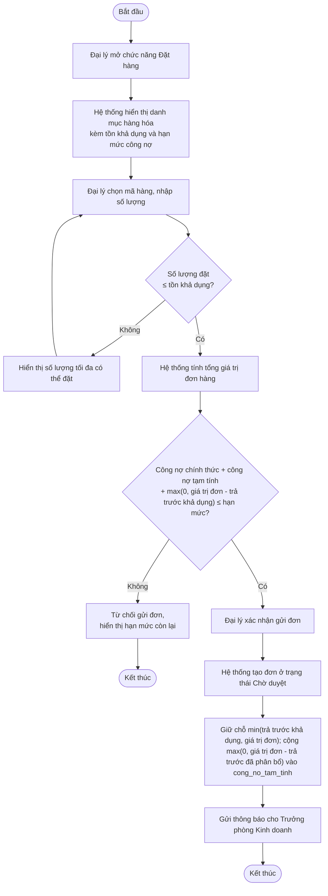
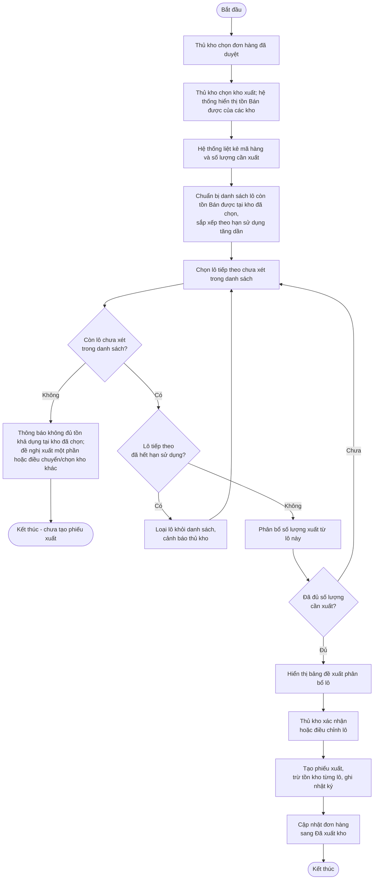
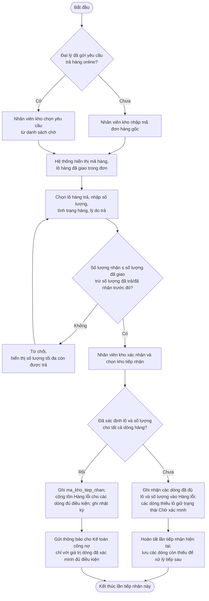
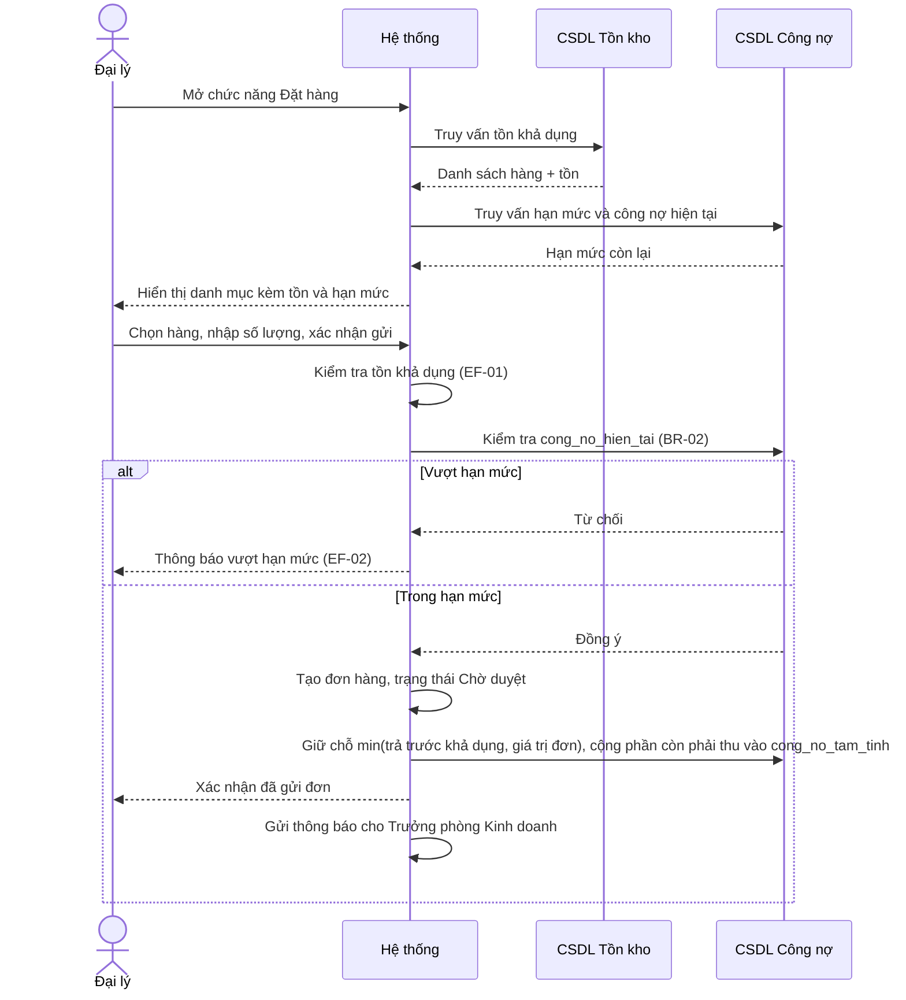
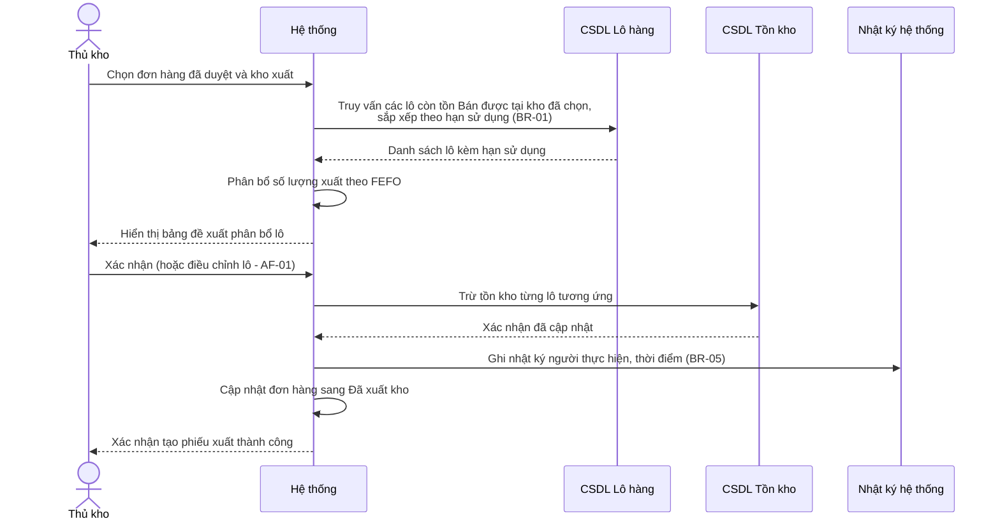

# Kiến trúc hệ thống

> **Lưu ý:** nội dung khảo sát và luật nghiệp vụ là **kịch bản giả lập/đề xuất** nhằm phục vụ phân tích và thiết kế dự án, không phải khảo sát thực tế.

## Công nghệ đề xuất

<b>Bảng 2.4. Công nghệ dự kiến triển khai</b>

| Thành phần | Lựa chọn đề xuất | Lý do |
|---|---|---|
| Backend | Java Spring Boot (hoặc ASP.NET Core - tùy thế mạnh của nhóm) | Có sẵn cơ chế phân quyền theo vai trò (FR-12), hỗ trợ transaction - cần thiết khi trừ tồn kho nhiều lô cùng lúc trong UC-XK-01 |
| Cơ sở dữ liệu | PostgreSQL hoặc MySQL (quan hệ) | ERD ở Chương 4 có 22 thực thể ràng buộc khóa ngoại chặt chẽ (đặc biệt LO_HANG - TON_KHO - CT_PHIEU_XUAT); hệ quản trị CSDL quan hệ đảm bảo toàn vẹn dữ liệu khi nhiều giao dịch xuất/nhập kho diễn ra đồng thời - cơ sở dữ liệu phi quan hệ (NoSQL) không phù hợp cho bài toán này |
| Frontend | ReactJS (hoặc Vue.js) | Phù hợp giao diện nhiều bảng biểu, lọc/tra cứu tương tác (Chương 6) |
| Xác thực | JWT (JSON Web Token) | Đơn giản hóa việc phân biệt quyền giữa 6 tác nhân (NFR-03) |

## Xác thực và phân quyền

- Phân quyền theo vai trò cho 6 tác nhân (FR-12); mật khẩu lưu dạng băm (NFR-03); xác thực đề xuất dùng JWT.
- Tài khoản đại lý gắn với một đại lý qua `NGUOI_DUNG.ma_dai_ly` để đại lý chỉ xem đơn hàng và công nợ của chính mình; tài khoản nhân viên nội bộ để trống trường này (mục 4.3, xem [04-database.md](04-database.md)).
- Luồng tài khoản: đăng nhập (UC-HT-01), quên mật khẩu (UC-HT-02) và đổi mật khẩu (UC-HT-03), hai use case sau là `extend` của UC-HT-01; quản lý tài khoản/phân quyền (UC-QT-01) và nhật ký hệ thống (UC-QT-02) xem tại [02-requirements.md](02-requirements.md).
- Sao lưu dữ liệu tự động hằng ngày (NFR-05, UC-QT-03).

## Luồng nghiệp vụ và tương tác

## 5.4. Activity Diagram

<i>Hình 5.8. Activity Diagram - Đại lý đặt hàng</i>

<i>Hình 5.9. Activity Diagram - Xuất kho theo FEFO</i>

<i>Hình 5.10. Activity Diagram - Ghi nhận hàng trả lại</i>

## 5.5. Sequence Diagram

<i>Hình 5.11. Sequence Diagram - Đại lý đặt hàng</i>

<i>Hình 5.12. Sequence Diagram - Xuất kho theo FEFO</i>

<!-- ## Thiết kế giao diện

Giao diện được thiết kế theo nguyên tắc mỗi vai trò chỉ thấy các chức năng thuộc quyền của mình (theo FR-12).

**Giao diện đăng nhập.** Form nhập tên đăng nhập và mật khẩu, sau khi xác thực thành công hệ thống điều hướng đến dashboard tương ứng vai trò.

*Hình 6.1. Giao diện đăng nhập*

**Giao diện đặt hàng của đại lý.** Hiển thị danh mục hàng hóa kèm tồn khả dụng, và đặc biệt là **thanh hạn mức công nợ còn lại** đặt ở vị trí dễ thấy - giải quyết trực tiếp phản ánh của đại lý trong khảo sát rằng họ không biết hạn mức còn lại cho đến khi bị từ chối đơn.

*Hình 6.2. Giao diện đặt hàng của đại lý*

**Giao diện phiếu xuất kho.** Hiển thị bảng đề xuất phân bổ lô hàng theo FEFO, mỗi dòng ghi rõ mã lô và hạn sử dụng để thủ kho đối chiếu trước khi xác nhận.

*Hình 6.3. Giao diện phiếu xuất kho*

**Giao diện theo dõi công nợ đại lý.** Bảng danh sách 200 đại lý kèm hạn mức, công nợ hiện tại và tỷ lệ sử dụng hạn mức, có tô màu cảnh báo khi đại lý gần chạm hạn mức.

*Hình 6.4. Giao diện theo dõi công nợ đại lý*

**Giao diện báo cáo tồn kho hợp nhất.** Hiển thị tồn kho của 600 mã hàng theo từng kho và cột tổng hợp 3 kho, có bộ lọc theo hàng cận hạn sử dụng.

*Hình 6.5. Giao diện báo cáo tồn kho hợp nhất*

> Báo cáo nguồn chỉ có chú thích Hình 6.1–6.5, **chưa có file ảnh hay wireframe** đi kèm. Thiết kế giao diện dự kiến dùng Figma. -->